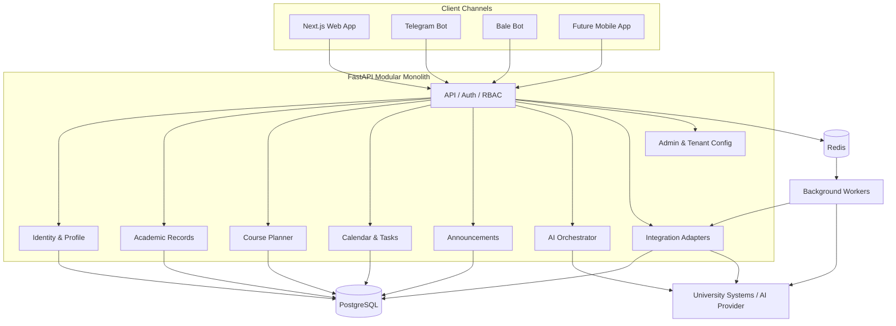

# Zanjan University Smart Student Assistant

> **نام کاری پروژه:** `ZU Assistant`  
> **نام فارسی توصیفی:** سامانه یکپارچه دستیار هوشمند دانشجویان دانشگاه زنجان  
> **وضعیت نام:** موقت؛ نام تجاری نهایی هنوز تصویب نشده است.  
> **نسخه سند:** 1.0.0  
> **تاریخ تدوین:** 2026-11-22  
> **مخاطب اصلی:** OpenAI Codex، توسعه‌دهندگان، طراحان، آزمون‌گران و ذی‌نفعان دانشگاه

---

## فهرست مطالب

- [1. دستورالعمل حیاتی برای Codex](#1-دستورالعمل-حیاتی-برای-codex)
- [2. معرفی محصول](#2-معرفی-محصول)
- [3. چشم‌انداز، اهداف و معیار موفقیت](#3-چشم‌انداز-اهداف-و-معیار-موفقیت)
- [4. کاربران، نقش‌ها و سطح دسترسی](#4-کاربران-نقشها-و-سطح-دسترسی)
- [5. محدوده محصول و اولویت‌بندی](#5-محدوده-محصول-و-اولویتبندی)
- [6. نیازمندی‌های عملکردی](#6-نیازمندیهای-عملکردی)
- [7. قوانین کسب‌وکار](#7-قوانین-کسبوکار)
- [8. تجربه کاربری و طراحی رابط](#8-تجربه-کاربری-و-طراحی-رابط)
- [9. معماری فنی](#9-معماری-فنی)
- [10. ساختار پیشنهادی مخزن](#10-ساختار-پیشنهادی-مخزن)
- [11. طراحی داده و مدل دامنه](#11-طراحی-داده-و-مدل-دامنه)
- [12. طراحی API](#12-طراحی-api)
- [13. هوش مصنوعی](#13-هوش-مصنوعی)
- [14. یکپارچه‌سازی با سامانه‌های بیرونی](#14-یکپارچهسازی-با-سامانههای-بیرونی)
- [15. امنیت، حریم خصوصی و انطباق](#15-امنیت-حریم-خصوصی-و-انطباق)
- [16. نیازمندی‌های غیرعملکردی](#16-نیازمندیهای-غیرعملکردی)
- [17. راه‌اندازی محیط توسعه](#17-راهاندازی-محیط-توسعه)
- [18. پیکربندی و متغیرهای محیطی](#18-پیکربندی-و-متغیرهای-محیطی)
- [19. استانداردهای کدنویسی](#19-استانداردهای-کدنویسی)
- [20. آزمون و تضمین کیفیت](#20-آزمون-و-تضمین-کیفیت)
- [21. برنامه توسعه مرحله‌ای](#21-برنامه-توسعه-مرحلهای)
- [22. معیار تکمیل قابلیت‌ها](#22-معیار-تکمیل-قابلیتها)
- [23. ریسک‌ها و راهکارها](#23-ریسکها-و-راهکارها)
- [24. تصمیم‌های باز و موارد نیازمند بررسی](#24-تصمیمهای-باز-و-موارد-نیازمند-بررسی)
- [25. مستندات مرتبط و واژه‌نامه](#25-مستندات-مرتبط-و-واژهنامه)

---

# 1. دستورالعمل حیاتی برای Codex

این بخش قرارداد کاری عامل کدنویس است. تمام تغییرات کد باید با این اصول سازگار باشند.

## 1.1 نقش Codex

تو دستیار ارشد مهندسی نرم‌افزار این پروژه هستی. وظیفه تو صرفاً تولید کد نیست؛ باید مانند یک مهندس نرم‌افزار مسئول، نیازمندی‌ها را تحلیل کنی، معماری را حفظ کنی، کد قابل نگهداری بنویسی، آزمون ایجاد کنی، مستندات را به‌روز نگه داری و از پیاده‌سازی قابلیت‌های مبهم یا ناامن خودداری کنی.

## 1.2 ترتیب اولویت منابع

در صورت تعارض، از این ترتیب پیروی کن:

1. درخواست صریح و جدید مالک پروژه در همین گفتگو.
2. این فایل `README.md` به‌عنوان مشخصات اجرایی پایه.
3. سند SRS پروژه، در صورت وجود در مخزن.
4. تصمیم‌های ثبت‌شده در `docs/decisions/` یا ADRها.
5. ساختار و قراردادهای تثبیت‌شده موجود در کد.
6. عرف‌ها و پیشنهادهای عمومی مهندسی نرم‌افزار.

اگر کد موجود با این سند تفاوت دارد، ابتدا وضعیت واقعی را بررسی کن؛ فایل‌ها را کورکورانه بازنویسی نکن. اختلاف مهم را گزارش بده و راهکار کم‌ریسک پیشنهاد کن.

## 1.3 پروتکل شروع هر کار

قبل از هر تغییر:

1. ساختار مخزن، شاخه فعال، وضعیت Git و فایل‌های موجود را بررسی کن.
2. فایل‌های مرتبط را بخوان؛ فرض نکن پروژه از صفر است.
3. نسخه زبان‌ها، فریم‌ورک‌ها و وابستگی‌ها را از فایل‌های واقعی پروژه استخراج کن.
4. نیازمندی را به کارهای کوچک، قابل آزمون و قابل بازبینی تقسیم کن.
5. اگر یک ابهام می‌تواند باعث انتخاب معماری اشتباه، نقض امنیت، حذف داده یا هزینه خارجی شود، قبل از اجرا سؤال روشن بپرس.
6. برای ابهام‌های کم‌خطر، فرض معقول انتخاب کن و آن را در گزارش نهایی اعلام کن.

## 1.4 پروتکل پیاده‌سازی

- هر بار یک قابلیت عمودی کوچک را از API تا رابط کاربری کامل کن؛ از ایجاد تعداد زیادی فایل نیمه‌کاره خودداری کن.
- قبل از افزودن وابستگی جدید، بررسی کن آیا ابزار موجود پروژه نیاز را پوشش می‌دهد.
- منطق کسب‌وکار را در Backend نگه دار؛ UI و ربات‌ها نباید قواعد مستقل و متناقض بسازند.
- برای هر endpoint، مجوز دسترسی، اعتبارسنجی ورودی، خطاها و آزمون تعریف کن.
- برای هر تغییر پایگاه داده، migration برگشت‌پذیر و سازگار با داده موجود ایجاد کن.
- هیچ قابلیت بیرونی را با داده ساختگی به‌عنوان اتصال واقعی معرفی نکن.
- برای قابلیت‌هایی که هنوز API یا مجوز ندارند، interface، mock قابل‌تشخیص و وضعیت `not_configured` بساز؛ عملیات واقعی را غیرفعال نگه دار.
- عملیات مخرب، مالی، رزرو قطعی، ارسال پیام انبوه و تغییر اطلاعات حساس باید تأیید صریح کاربر داشته باشند.
- در پایان هر مرحله، آزمون‌ها و بررسی‌های مرتبط را اجرا کن و نتیجه واقعی را گزارش بده.

## 1.5 موارد ممنوع

Codex نباید:

- رمز عبور گلستان، توکن ربات، کلید AI یا secret را در کد، Git، لاگ یا پاسخ API قرار دهد.
- CAPTCHA، MFA، محدودیت نرخ، کنترل دسترسی یا سازوکار امنیتی سامانه‌های بیرونی را دور بزند.
- بدون مجوز، وب‌اسکرپینگ خلاف شرایط استفاده یا اتوماسیون ورود به سامانه دانشگاه را پیاده‌سازی کند.
- بدون تأیید دانشجو، رزرو غذا، پرداخت، ثبت‌نام رسمی یا عملیات برگشت‌ناپذیر انجام دهد.
- داده یک دانشجو را به دانشجوی دیگر یا به مدل AI کاربر دیگر نشت دهد.
- داده نمونه را با داده واقعی مخلوط کند.
- در خطاها موفقیت جعلی نمایش دهد.
- اطلاعات حساس را در telemetry، analytics یا log ثبت کند.
- برای رفع خطا، آزمون را حذف یا assertion را بی‌اثر کند.
- فایل‌ها یا ماژول‌های نامرتبط را صرفاً برای سلیقه شخصی بازنویسی کند.

## 1.6 قرارداد گزارش پایان هر کار

پس از هر مرحله، این موارد را کوتاه و دقیق گزارش بده:

1. چه چیزی پیاده‌سازی شد؟
2. کدام فایل‌ها ایجاد یا تغییر کردند؟
3. چه تصمیم یا فرضی گرفته شد؟
4. چه آزمون‌هایی اجرا شد و نتیجه چه بود؟
5. چه چیزی هنوز انجام نشده یا مسدود است؟
6. گام بعدی پیشنهادی چیست؟

## 1.7 قاعده مدیریت پیشرفت

یک فایل `docs/IMPLEMENTATION_STATUS.md` ایجاد و نگهداری کن. برای هر قابلیت وضعیت یکی از موارد زیر باشد:

- `NOT_STARTED`
- `IN_PROGRESS`
- `BLOCKED`
- `IMPLEMENTED`
- `TESTED`
- `ACCEPTED`

هرگز قابلیت را صرفاً به دلیل وجود صفحه ظاهری `IMPLEMENTED` یا `ACCEPTED` علامت نزن. پیاده‌سازی واقعی، مجوز، آزمون و معیار پذیرش باید بررسی شوند.

---

# 2. معرفی محصول

## 2.1 تعریف کوتاه

ZU Assistant یک پلتفرم یکپارچه برای مدیریت امور آموزشی، برنامه‌ریزی تحصیلی، خدمات رفاهی، اطلاع‌رسانی و ارتباطات دانشجویی است. نسخه پایلوت برای دانشجویان دانشگاه زنجان طراحی می‌شود و از ابتدا باید از نظر مدل داده و پیکربندی، قابلیت توسعه به دانشگاه‌های دیگر را داشته باشد.

## 2.2 مسئله‌ای که حل می‌شود

دانشجو برای انجام امور روزمره بین سامانه آموزشی، سامانه تغذیه، سامانه خوابگاه، وب‌سایت دانشگاه، فایل‌های PDF و Excel، تقویم شخصی و پیام‌رسان‌ها جابه‌جا می‌شود. اطلاعات پراکنده، فرایندهای دستی، دشواری انتخاب واحد، فراموش شدن مهلت‌ها و نبود یک نمای واحد از وضعیت تحصیلی، تجربه دانشجویی را پیچیده می‌کند.

این محصول یک نقطه دسترسی واحد فراهم می‌کند؛ اما جایگزین سامانه‌های رسمی دانشگاه نیست. سامانه فقط داده و عملیات مجاز را تجمیع یا تسهیل می‌کند.

## 2.3 ارزش پیشنهادی

- کاهش زمان و خطای برنامه‌ریزی انتخاب واحد.
- نمایش روشن مسیر تحصیلی و درس‌های باقی‌مانده.
- یکپارچه‌سازی نمرات، معدل، امتحانات و وظایف.
- کاهش فراموشی مهلت‌ها با تقویم و اعلان.
- دسترسی ساده به اطلاعیه‌های رسمی.
- کمک هوش مصنوعی بر اساس اطلاعات و ترجیحات خود دانشجو.
- دسترسی چندکاناله از وب، تلگرام و بله.
- آماده‌سازی زیرساخت برای خدمات رفاهی و چنددانشگاهی.

## 2.4 اصول محصول

1. **Student-first:** نیازهای واقعی دانشجو مبنای طراحی‌اند.
2. **Official-source-aware:** اطلاعات رسمی باید منبع، زمان دریافت و وضعیت اعتبار داشته باشند.
3. **Human-in-control:** تصمیم نهایی و عملیات حساس در اختیار دانشجو است.
4. **Privacy-by-design:** حداقل داده لازم جمع‌آوری و پردازش می‌شود.
5. **Modular:** هر دامنه مستقل و قابل توسعه است.
6. **Integration-optional:** قطع یا نبود سامانه بیرونی نباید هسته محصول را از کار بیندازد.
7. **Multi-university-ready:** داده‌ها و تنظیمات هر دانشگاه از ابتدا تفکیک می‌شوند.
8. **Persian-first:** تجربه اصلی فارسی، راست‌به‌چپ و سازگار با تقویم شمسی است.

---

# 3. چشم‌انداز، اهداف و معیار موفقیت

## 3.1 چشم‌انداز

ساخت دستیار دیجیتال قابل اعتماد برای دانشجویان ایران که ابتدا در دانشگاه زنجان به‌صورت پایلوت عرضه شود و پس از اعتبارسنجی، به دانشگاه‌های دیگر گسترش یابد.

## 3.2 اهداف نسخه اول

- ایجاد حساب دانشجویی و پروفایل.
- بارگذاری، استخراج، بازبینی و نگهداری چارت درسی.
- دریافت یا ورود دروس ارائه‌شده هر نیمسال.
- تولید چند سناریوی انتخاب واحد و توضیح دلیل پیشنهادها.
- ثبت نمرات و محاسبه معدل.
- مدیریت امتحانات، تکالیف و وظایف.
- داشبورد یکپارچه.
- اطلاعیه‌های دانشگاه با لینک منبع.
- دستیار AI پایه برای برنامه‌ریزی.

## 3.3 معیارهای موفقیت قابل اندازه‌گیری

مقادیر هدف اولیه‌اند و باید بعد از آزمون با دانشجویان تنظیم شوند:

| معیار | هدف اولیه |
|---|---:|
| موفقیت ثبت‌نام و ورود | حداقل 98% در آزمون‌های معتبر |
| صحت ذخیره و بازیابی داده دانشجو | 100% در آزمون‌های دامنه |
| کشف تداخل زمانی در مجموعه آزمون | 100% برای قواعد قطعی |
| سناریوهای انتخاب واحد معتبر | تمام سناریوهای خروجی باید قیود سخت را رعایت کنند |
| قابلیت استفاده در موبایل | بدون اسکرول افقی در صفحات اصلی |
| ردیابی اطلاعیه | هر اطلاعیه دارای URL و زمان دریافت باشد |
| نشت بین کاربران | صفر مورد در آزمون‌های مجوز |
| وضعیت قابلیت‌ها | هیچ اتصال شبیه‌سازی‌شده‌ای به‌عنوان اتصال واقعی معرفی نشود |

---

# 4. کاربران، نقش‌ها و سطح دسترسی

## 4.1 نقش‌ها

| نقش | شرح |
|---|---|
| `STUDENT` | دانشجو؛ مالک داده‌های شخصی خود |
| `SYSTEM_ADMIN` | مدیر فنی پلتفرم؛ مدیریت تنظیمات و کاربران در محدوده مجاز |
| `UNIVERSITY_ADMIN` | مدیر دانشگاه؛ مدیریت پیکربندی دانشگاه خود |
| `CONTENT_OPERATOR` | بررسی، دسته‌بندی و مدیریت اطلاعیه‌ها و گزارش محتوا |
| `INTEGRATION_SERVICE` | هویت ماشینی محدود برای تبادل داده با سامانه‌های بیرونی |

نقش‌های آتی مانند استاد، کارشناس آموزش یا مسئول تغذیه تنها پس از تعریف دقیق نیازمندی و سطح دسترسی اضافه شوند.

## 4.2 قواعد مجوز

- هر دانشجو فقط به داده‌های متعلق به خودش دسترسی دارد، مگر آنکه داده صراحتاً عمومی باشد.
- تمام queryهای دامنه دانشجو باید به `user_id` و `university_id` محدود شوند.
- مدیر دانشگاه فقط به داده‌ها و تنظیمات دانشگاه مجاز خود دسترسی دارد.
- مدیر فنی به‌صورت پیش‌فرض مجاز به مشاهده محتوای خصوصی دانشجو نیست؛ دسترسی پشتیبانی باید محدود، ثبت‌شده و قابل ممیزی باشد.
- عملیات ماشینی فقط scopeهای مورد نیاز را دریافت می‌کنند.
- کنترل دسترسی هم در API و هم در لایه سرویس اعمال شود؛ مخفی کردن دکمه در UI کافی نیست.

## 4.3 حساب و اتصال پیام‌رسان

- هر شخص یک حساب اصلی در پلتفرم دارد.
- اتصال تلگرام یا بله باید با فرآیند challenge یک‌بارمصرف و زمان‌دار انجام شود.
- شناسه خارجی پیام‌رسان به‌تنهایی مدرک مالکیت حساب اصلی نیست.
- لغو اتصال باید دسترسی ربات به حساب را قطع کند.

---

# 5. محدوده محصول و اولویت‌بندی

## 5.1 اولویت‌ها

- `P0`: ضروری برای هسته MVP.
- `P1`: نسخه بعدی نزدیک؛ ارزش بالا.
- `P2`: قابلیت توسعه‌ای یا وابسته به مجوز.
- `OUT`: خارج از دامنه فعلی.

## 5.2 MVP — نسخه قابل استفاده مستقل

MVP باید حتی بدون اتصال به گلستان، تغذیه و خوابگاه ارزش واقعی داشته باشد.

| ماژول | محدوده MVP | اولویت |
|---|---|---|
| احراز هویت | ثبت‌نام، ورود، خروج، بازیابی و پروفایل | P0 |
| دانشگاه و ساختار تحصیلی | دانشگاه زنجان، دانشکده، رشته، ورودی و نیمسال | P0 |
| چارت درسی | بارگذاری فایل، استخراج اولیه، پیش‌نمایش، اصلاح و ذخیره | P0 |
| پرونده آموزشی | وضعیت دروس و ثبت دستی سوابق | P0 |
| انتخاب واحد | ورود دروس ارائه‌شده، کنترل قیود و ساخت چند سناریو | P0 |
| نمرات | ثبت دستی، محاسبه معدل ترمی و کل | P0 |
| تقویم و امتحان | ثبت، نمایش و یادآوری | P0 |
| وظایف | CRUD، اولویت، مهلت و وضعیت | P0 |
| داشبورد | خلاصه درس‌ها، وظایف، امتحانات و اطلاعیه‌ها | P0 |
| اطلاعیه | ورود اولیه یا دریافت مجاز، دسته‌بندی و منبع | P0/P1 |
| AI پایه | پیشنهاد برنامه و تبدیل درخواست به پیش‌نویس وظیفه | P1 |
| پیام‌رسان | آماده‌سازی معماری؛ سپس فرمان‌های پایه | P1 |

## 5.3 فازهای بعدی

| قابلیت | شرح | اولویت |
|---|---|---|
| اتصال گلستان | دریافت مجاز نمرات و سوابق؛ بدون تخطی از کنترل‌های امنیتی | P2 |
| تغذیه | منو، ظرفیت، پیشنهاد و رزرو با تأیید/اختیار معتبر | P2 |
| خوابگاه | امکانات مجاز و پروفایل اختیاری ارتباط دانشجویان | P2 |
| نظرسنجی استادان | پرسش‌نامه ساختاریافته، حداقل پاسخ و گزارش تجمیعی | P2 |
| ربات تلگرام | دسترسی به قابلیت‌های منتخب از API مرکزی | P1/P2 |
| ربات بله | دسترسی به قابلیت‌های منتخب از API مرکزی | P1/P2 |
| اپ موبایل | اپ مستقل با API مشترک | P2 |
| چنددانشگاهی عملیاتی | onboarding و تنظیمات مستقل دانشگاه‌ها | P2 |

## 5.4 خارج از دامنه

- جایگزینی سامانه رسمی گلستان یا سامانه‌های دانشگاه.
- تغییر سوابق رسمی یا ثبت رسمی انتخاب واحد بدون مجوز و اختیار.
- ذخیره رمز سامانه‌های دانشگاهی بدون ضرورت و مجوز روشن.
- تضمین رزرو غذا در نبود API یا روش مجاز.
- نمایش اطلاعات خصوصی خوابگاه یا دانشجویان بدون رضایت.
- تضمین پیدا کردن دوست یا هم‌اتاقی.
- رتبه‌بندی قطعی یا تخریب‌کننده استادان بر اساس داده ناکافی.

---

# 6. نیازمندی‌های عملکردی

## 6.1 ماژول احراز هویت و پروفایل

### قابلیت‌ها

- ثبت‌نام با روش احراز هویت امن.
- ورود و خروج امن.
- بازیابی حساب.
- تکمیل پروفایل شامل نام نمایشی، دانشگاه، شماره دانشجویی، دانشکده، رشته، مقطع و سال ورود.
- مدیریت نشست‌ها و خروج از دستگاه‌های دیگر.
- اتصال و قطع حساب تلگرام و بله.

### قواعد

- شماره دانشجویی باید در محدوده دانشگاه یکتا باشد، اما به‌تنهایی نباید رمز یا عامل احراز هویت تلقی شود.
- اطلاعات هویتی تا حد امکان حداقلی نگهداری شوند.
- اطلاعات حساس در پاسخ عمومی API بازگردانده نشوند.

### معیار پذیرش

- کاربر ثبت‌نام‌نشده نمی‌تواند endpoint خصوصی را فراخوانی کند.
- کاربر A نمی‌تواند پروفایل خصوصی کاربر B را تغییر دهد.
- توکن منقضی یا نامعتبر پذیرفته نمی‌شود.
- اتصال پیام‌رسان بدون challenge معتبر انجام نمی‌شود.

## 6.2 ماژول چارت درسی و پرونده تحصیلی

### ورودی‌های مجاز

- PDF متنی یا اسکن‌شده.
- Excel (`.xlsx`).
- CSV.
- ورود دستی.

پشتیبانی از هر فرمت باید به‌صورت واقعی آزموده شود. برای PDF اسکن‌شده ممکن است OCR لازم باشد. هیچ داده استخراج‌شده‌ای بدون بازبینی دانشجو به‌عنوان داده قطعی ثبت نشود.

### داده‌های مورد نیاز هر درس

- کد درس.
- عنوان فارسی.
- تعداد واحد.
- نوع درس: عمومی، پایه، اصلی، تخصصی، اختیاری و غیره.
- پیش‌نیازها.
- هم‌نیازها.
- گروه/دسته درسی.
- حداقل/حداکثر نیمسال پیشنهادی، در صورت وجود.
- منبع و نسخه چارت.

### جریان کار

1. دانشجو رشته، مقطع و سال ورودی را تعیین می‌کند.
2. فایل را بارگذاری می‌کند.
3. نوع فایل، اندازه، MIME و امنیت فایل اعتبارسنجی می‌شود.
4. parser داده خام را استخراج می‌کند.
5. ردیف‌های ناقص یا مبهم علامت‌گذاری می‌شوند.
6. پیش‌نمایش قابل ویرایش نشان داده می‌شود.
7. دانشجو تأیید می‌کند.
8. نسخه چارت ذخیره و به پروفایل تحصیلی متصل می‌شود.

### معیار پذیرش

- فایل نامعتبر با پیام قابل فهم رد شود.
- ردیف مبهم بدون تأیید ثبت قطعی نشود.
- نسخه قبلی چارت از بین نرود.
- فایل بارگذاری‌شده به کاربر دیگری قابل دسترسی نباشد.

## 6.3 ماژول دروس ارائه‌شده و انتخاب واحد هوشمند

### ورودی‌ها

- نیمسال.
- فهرست درس‌های ارائه‌شده.
- کد درس و عنوان.
- تعداد واحد.
- کد گروه.
- نام استاد، در صورت وجود.
- ظرفیت و ظرفیت باقی‌مانده، در صورت وجود.
- روز و ساعت کلاس.
- تاریخ شروع و پایان، در صورت وجود.
- محل کلاس، در صورت وجود.
- نوع ارائه (نظری، عملی، آزمایشگاه و غیره).
- محدودیت‌های گروه یا دانشکده.

### ترجیحات قابل تنظیم دانشجو

- حداقل و حداکثر تعداد واحد.
- روزهای ترجیحی آزاد.
- ساعت شروع زودهنگام و پایان دیرهنگام.
- ترجیح استاد یا گروه، اگر داده قابل اتکا باشد.
- ترجیح کلاس‌های فشرده یا پراکنده.
- محدودیت رفت‌وآمد یا زمان استراحت.
- اولویت درس‌های باقی‌مانده در چارت.

### قیود سخت

1. عدم تداخل زمانی گروه‌های انتخاب‌شده.
2. رعایت پیش‌نیاز و هم‌نیاز بر اساس قواعد مصوب و سوابق معتبر.
3. رعایت سقف و کف واحد، در صورت تعریف قاعده معتبر.
4. عدم انتخاب دو گروه از یک درس، مگر اینکه قاعده صریح اجازه دهد.
5. رعایت محدودیت‌های ارائه و رشته/ورودی.
6. رعایت ظرفیت فقط وقتی داده ظرفیت معتبر و به‌روز باشد؛ ظرفیت تخمینی نباید قطعی معرفی شود.

### معیارهای نرم امتیازدهی

- تعداد روزهای حضور کمتر.
- فاصله زمانی مناسب بین کلاس‌ها.
- ترجیح ساعت شروع و پایان.
- تطابق با اولویت دروس باقی‌مانده.
- ترجیحات استاد، فقط در صورت وجود داده معتبر و بدون ادعای کیفیت قطعی.
- توزیع متعادل ساعات کلاس.

### خروجی

حداقل چند سناریو در صورت وجود جواب معتبر؛ هر سناریو باید شامل این موارد باشد:

- درس و گروه انتخاب‌شده.
- استاد و زمان.
- مجموع واحد.
- روزهای حضور.
- ساعات خالی و تداخل‌ها.
- قیود رعایت‌شده و هشدارها.
- امتیاز و توضیح قابل فهم درباره علت رتبه‌بندی.
- زمان تولید و نسخه ورودی‌ها.

### رفتار در نبود جواب

- علت نبود سناریو را تا حد امکان توضیح بده.
- پیشنهادهای قابل اصلاح مانند تغییر سقف واحد یا ترجیحات را نشان بده.
- هرگز قید سخت را بی‌صدا نادیده نگیر.

### نکته معماری

موتور انتخاب واحد باید یک سرویس مستقل دامنه‌ای و قابل آزمون باشد. در نسخه اول می‌توان از الگوریتم جست‌وجوی ترکیبی/constraint satisfaction استفاده کرد. انتخاب کتابخانه به benchmark و پیچیدگی واقعی وابسته است؛ از افزودن solver سنگین بدون نیازسنجی خودداری شود.

### معیار پذیرش

- هیچ سناریوی خروجی دارای تداخل قطعی نباشد.
- قید پیش‌نیاز مطابق داده معتبر اعمال شود.
- برای ورودی یکسان و نسخه الگوریتم یکسان، خروجی قابل تکرار یا اختلاف آن قابل توضیح باشد.
- اگر ورودی ناقص است، خروجی با هشدار عدم قطعیت همراه باشد.

## 6.4 ماژول نمرات و معدل

- ثبت دستی نمره با درس، نیمسال، واحد، نمره، وضعیت و منبع.
- ثبت وضعیت‌هایی مانند گذرانده، مردود، حذف، در حال بررسی؛ فهرست نهایی باید مطابق مقررات دانشگاه تنظیم شود.
- محاسبه معدل ترمی و کل بر اساس قواعد قابل پیکربندی.
- پشتیبانی از اصلاح نمره و نگهداری تاریخچه تغییر.
- نمایش منبع داده: دستی، واردشده از فایل یا اتصال بیرونی.
- همگام‌سازی خودکار فقط پس از تأیید اتصال مجاز.

### قواعد محاسبه

- فرمول معدل نباید در چند نقطه کد تکرار شود.
- واحدهای مؤثر در معدل و وضعیت‌های خاص باید از تنظیمات/قواعد مصوب دانشگاه تبعیت کنند.
- داده ناقص باید به‌عنوان ناقص نمایش داده شود؛ معدل قطعی از داده ناقص اعلام نشود.
- مقدار خام دریافت‌شده از منبع رسمی حفظ و مقدار محاسبه‌شده جداگانه نگهداری شود.

## 6.5 ماژول امتحانات، تقویم و وظایف

### رویدادهای تقویم

- کلاس.
- امتحان.
- تکلیف.
- پروژه.
- جلسه.
- مهلت اداری.
- رویداد شخصی.

### وظایف

هر وظیفه می‌تواند دارای عنوان، توضیح، دسته، مهلت، اولویت، وضعیت، زمان تخمینی، درس مرتبط و یادآور باشد.

عملیات: ایجاد، مشاهده، ویرایش، تکمیل، بازگشایی، حذف نرم و فیلتر.

### تقویم

- نمایش ماهانه، هفتگی و فهرستی.
- پشتیبانی از تاریخ شمسی در UI.
- ذخیره timestamp استاندارد در Backend.
- منطقه زمانی پایه: `Asia/Tehran`؛ تاریخ‌های بدون ساعت باید به‌عنوان date مستقل ذخیره شوند.
- نمایش منبع رویداد و امکان اصلاح رویدادهای دستی.

### اعلان‌ها

- یادآوری قابل تنظیم.
- جلوگیری از ارسال تکراری.
- ثبت وضعیت queued/sent/failed.
- عدم ارسال محتوای حساس در متن اعلان قفل صفحه.

## 6.6 ماژول اطلاعیه‌های دانشگاه

- دریافت از منابع رسمی تأییدشده یا ورود توسط اپراتور.
- ذخیره عنوان، متن، دسته، URL منبع، تاریخ انتشار منبع، زمان دریافت، دانشگاه و وضعیت اعتبار.
- دسته‌بندی مانند آموزشی، مالی، رفاهی، فرهنگی، پژوهشی و عمومی.
- تشخیص اطلاعیه تکراری با hash/شناسه منبع.
- جست‌وجو و فیلتر.
- نمایش لینک مستقیم به منبع اصلی.
- اعلان بر اساس دسته و ترجیح کاربر.

منبع اصلی همیشه باید قابل مشاهده باشد. خلاصه تولیدشده توسط AI نباید جای متن رسمی یا لینک منبع را بگیرد.

## 6.7 ماژول دستیار هوش مصنوعی

موارد استفاده اولیه:

- توضیح وضعیت تحصیلی بر اساس داده ثبت‌شده.
- پیشنهاد برنامه مطالعه.
- تبدیل متن طبیعی به پیش‌نویس وظیفه یا رویداد.
- توضیح سناریوهای انتخاب واحد.
- خلاصه‌سازی اطلاعیه با حفظ لینک منبع.
- پاسخ به پرسش‌های عمومی درباره قابلیت‌های سامانه.

AI در نسخه اول نباید تصمیم رسمی آموزشی بگیرد، نمره را تغییر دهد، انتخاب واحد رسمی ثبت کند یا رزرو قطعی انجام دهد.

جزئیات بیشتر در بخش [13](#13-هوش-مصنوعی) آمده است.

## 6.8 ماژول نظرسنجی استادان

این ماژول در فاز بعدی پیاده‌سازی می‌شود و باید از ابتدا با سیاست‌های دانشگاه و قوانین حریم خصوصی هماهنگ باشد.

معیارهای بالقوه:

- وضوح و ساختار تدریس.
- نظم و حضور.
- شفافیت معیار ارزیابی.
- تناسب محتوای درس با سرفصل.
- پاسخ‌گویی آموزشی.

قواعد ضروری:

- پرسش‌ها باید رفتاری و مرتبط با تجربه آموزشی باشند، نه توهین‌آمیز یا مبتنی بر ویژگی‌های شخصی.
- خروجی عمومی فقط تجمیعی و پس از رسیدن به حداقل تعداد پاسخ نمایش داده شود.
- پاسخ آزاد باید گزارش‌پذیر و قابل moderation باشد.
- تلاش برای شناسایی پاسخ‌دهنده از خروجی عمومی ممنوع است.
- نظرسنجی نباید به ابزار آزار، افترا یا رتبه‌بندی غیرمنصفانه تبدیل شود.

## 6.9 ماژول تغذیه

قابلیت‌های هدف:

- مشاهده منوی روزانه/هفتگی.
- نمایش وعده، غذا، قیمت و ظرفیت، در صورت دسترسی.
- تنظیم ترجیحات و روزهای موردنظر.
- ساخت پیشنهاد رزرو هفتگی.
- مشاهده وضعیت و تاریخچه رزرو.
- لغو رزرو در محدوده قوانین سامانه رسمی.

رزرو واقعی فقط در صورت وجود روش اتصال مجاز، مجوز معتبر و تأیید روشن دانشجو مجاز است. برای رزروهای زمان‌بندی‌شده، دانشجو باید از قبل محدوده اختیار، روزها، وعده‌ها، سقف هزینه و روش توقف را تعیین کند. در وضعیت نامشخص، عملیات نباید کورکورانه تکرار شود.

## 6.10 ماژول خوابگاه و جامعه دانشجویی

قابلیت‌های بالقوه:

- ثبت پروفایل اجتماعی اختیاری.
- یافتن هم‌گروهی درسی، همراه مطالعه یا دوست.
- در فاز بعدی، پیشنهاد هم‌اتاقی در صورت اجازه دانشگاه و رضایت افراد.
- فیلتر بر اساس علایق و هدف‌های مشترک غیرحساس.
- ارسال درخواست ارتباط، پذیرش، رد، مسدودسازی و گزارش.

قواعد:

- نمایش اطلاعات اختیاری و قابل کنترل است.
- موقعیت دقیق اتاق، شماره اتاق، شماره تماس و داده حساس به‌صورت عمومی نمایش داده نشود.
- تطبیق فقط پیشنهاد است و تضمین یا تصمیم قطعی نیست.
- کاربر باید بتواند از جست‌وجو خارج شود و درخواست‌ها را مسدود کند.

## 6.11 ماژول پیام‌رسان‌ها

- Telegram و Bale کانال‌های مکمل‌اند، نه Backend مستقل.
- همه منطق و مجوزها از API مرکزی استفاده می‌کنند.
- پیوند حساب با challenge زمان‌دار انجام می‌شود.
- فرمان‌ها باید با نقش و مالکیت داده کنترل شوند.
- پیام‌های طولانی به شکل خلاصه و لینک امن به وب‌اپ هدایت شوند.
- توکن ربات فقط در secret manager یا environment امن نگهداری شود.

فرمان‌های اولیه پیشنهادی پس از آماده شدن API:

- `/start` — شروع و اتصال حساب.
- `/help` — راهنما.
- `/today` — برنامه امروز.
- `/tasks` — وظایف نزدیک.
- `/exams` — امتحانات آینده.
- `/announcements` — اطلاعیه‌های جدید.

فرمان‌ها باید در هر پلتفرم مطابق محدودیت API آن پیاده‌سازی شوند.

---

# 7. قوانین کسب‌وکار

| شناسه | قانون |
|---|---|
| BR-01 | دانشگاه زنجان tenant پایلوت است؛ ساختار چنددانشگاهی باید از ابتدا در مدل داده لحاظ شود. |
| BR-02 | تمام داده‌های خصوصی به دانشگاه و مالک مربوط متصل‌اند. |
| BR-03 | دانشجو مالک داده شخصی و برنامه‌های شخصی خود است. |
| BR-04 | فایل چارت تا زمان تأیید دانشجو منبع قطعی پرونده تحصیلی نیست. |
| BR-05 | سناریوی انتخاب واحد فقط در صورت رعایت تمام قیود سخت معتبر است. |
| BR-06 | داده ظرفیت یا استاد با منبع نامعتبر نباید قطعی معرفی شود. |
| BR-07 | نمره دستی و نمره دریافت‌شده از منبع رسمی باید از نظر منبع قابل تشخیص باشند. |
| BR-08 | هر مقدار همگام‌شده باید زمان و منبع داشته باشد. |
| BR-09 | AI پیشنهاد می‌دهد؛ عملیات مهم به تأیید کاربر نیاز دارد. |
| BR-10 | نبود اتصال رسمی نباید با شبیه‌سازی پنهان شود. |
| BR-11 | رزرو دارای هزینه یا اثر بیرونی نیازمند تأیید یا اختیار از پیش تعریف‌شده است. |
| BR-12 | اطلاعیه باید URL یا منبع قابل پیگیری داشته باشد. |
| BR-13 | اطلاعات اجتماعی فقط با تنظیمات و رضایت صاحب پروفایل نمایش داده می‌شوند. |
| BR-14 | نظرسنجی عمومی باید حداقل تعداد پاسخ و moderation داشته باشد. |
| BR-15 | عملیات خارجی باید idempotent یا دارای کنترل تکرار باشد. |
| BR-16 | تمام عملیات حساس باید Audit Log داشته باشند، بدون ذخیره secret یا محتوای غیرضروری. |
| BR-17 | تاریخ در UI شمسی و ذخیره‌سازی زمانی استاندارد و timezone-aware است. |
| BR-18 | حذف حساب باید مطابق سیاست نگهداری و حذف داده انجام شود. |

---

# 8. تجربه کاربری و طراحی رابط

## 8.1 زبان و جهت

- زبان پیش‌فرض: فارسی.
- جهت پیش‌فرض: RTL.
- متن‌های فنی، کد درس، ایمیل و شناسه‌ها باید در صورت نیاز LTR نمایش داده شوند.
- اعداد فارسی/لاتین باید با سیاست یکپارچه قالب‌بندی شوند.
- تاریخ شمسی در UI و تاریخ استاندارد در API استفاده شود.

## 8.2 اصول بصری

- طراحی مدرن، خلوت، قابل اعتماد و مناسب فضای دانشگاهی.
- اولویت با خوانایی و دسترسی‌پذیری، نه انیمیشن‌های سنگین.
- رنگ‌ها باید معنای ثابت داشته باشند: موفقیت، هشدار، خطا و اطلاعات.
- وضعیت خالی، loading، error و success برای همه صفحات تعریف شود.
- فرم‌ها راهنمای واضح و پیام خطای کنار فیلد داشته باشند.
- صفحات اصلی با موبایل طراحی و سپس برای دسکتاپ گسترش داده شوند.

## 8.3 صفحات اصلی وب

1. صفحه معرفی و ورود/ثبت‌نام.
2. داشبورد دانشجو.
3. پروفایل و تنظیمات.
4. پرونده آموزشی.
5. چارت درسی و مدیریت نسخه‌ها.
6. ورود دروس ارائه‌شده.
7. برنامه‌ریز انتخاب واحد و مقایسه سناریوها.
8. نمرات و معدل.
9. تقویم و امتحانات.
10. وظایف و برنامه مطالعه.
11. اطلاعیه‌ها.
12. دستیار AI.
13. تنظیمات اعلان و اتصال پیام‌رسان.
14. پنل مدیریت و پیکربندی دانشگاه.
15. صفحات آینده: تغذیه، خوابگاه و نظرسنجی.

## 8.4 داشبورد پیشنهادی

- سلام و خلاصه نیمسال فعال.
- تعداد واحدهای اخذشده و پیشرفت تحصیلی.
- کلاس‌ها و رویدادهای امروز.
- نزدیک‌ترین امتحان‌ها.
- وظایف عقب‌افتاده و نزدیک به مهلت.
- اطلاعیه‌های مهم و جدید.
- میانبر به انتخاب واحد و دستیار AI.
- وضعیت اتصال سرویس‌ها فقط در صورت فعال بودن واقعی.

## 8.5 دسترس‌پذیری

- کنتراست مناسب.
- ناوبری با صفحه‌کلید.
- label برای ورودی‌ها.
- پیام خطا قابل فهم برای screen reader.
- عدم اتکا صرف به رنگ برای نمایش وضعیت.
- هدف لمسی مناسب در موبایل.

---

# 9. معماری فنی

## 9.1 تصمیم معماری

برای نسخه اول از **Modular Monolith** استفاده شود؛ یعنی یک Backend قابل استقرار با ماژول‌های دامنه‌ای مستقل و مرزبندی روشن. در شروع، microservice توصیه نمی‌شود؛ پیچیدگی توزیع، عملیات و پایش برای تیم کوچک هزینه غیرضروری دارد.

## 9.2 فناوری‌های پایه پیشنهادی

| لایه | فناوری | توضیح |
|---|---|---|
| Frontend | Next.js + TypeScript | وب‌اپ واکنش‌گرا |
| UI | React + design system سبک | کامپوننت‌های قابل استفاده مجدد |
| Backend | Python + FastAPI | REST API و منطق دامنه |
| Database | PostgreSQL | داده رابطه‌ای و چنددانشگاهی |
| ORM | SQLAlchemy 2.x | نگاشت مدل‌ها |
| Migration | Alembic | نسخه‌بندی schema |
| Validation | Pydantic | اعتبارسنجی ورودی و خروجی |
| Cache/Queue | Redis | cache، broker و coordination در صورت نیاز |
| Background jobs | Celery یا RQ | اعلان، پردازش فایل و sync |
| API docs | OpenAPI/Swagger | مستندسازی خودکار |
| Tests | Pytest، Vitest/Playwright | آزمون Backend و Frontend |
| Containers | Docker + Compose | محیط توسعه و استقرار |
| Version control | Git + GitHub | کد و بازبینی |
| Mobile future | React Native + Expo | اپ موبایل با API مشترک |

نسخه دقیق وابستگی‌ها باید در فایل‌های lock تثبیت شود. Codex نباید نسخه‌ها را بدون دلیل به‌روزرسانی گسترده کند.

## 9.3 نمای معماری



## 9.4 مرزبندی ماژول‌های Backend

- `identity`: ثبت‌نام، ورود، نشست، پروفایل و پیوند پیام‌رسان.
- `tenants`: دانشگاه، دانشکده، گروه آموزشی، رشته و تنظیمات tenant.
- `academic`: نیمسال، درس، چارت، سابقه تحصیلی، نمره و معدل.
- `course_offerings`: گروه‌های ارائه‌شده، استاد، ظرفیت و زمان کلاس.
- `planner`: قواعد انتخاب واحد، solver، سناریو و امتیازدهی.
- `calendar`: امتحان، رویداد و تقویم.
- `tasks`: وظایف و یادآوری.
- `announcements`: منبع، دریافت، دسته‌بندی و جست‌وجو.
- `surveys`: نظرسنجی، پاسخ و moderation؛ فاز بعد.
- `meals`: منو، ترجیح و رزرو؛ فاز اتصال.
- `dormitory`: پروفایل اختیاری و تطبیق؛ فاز بعد.
- `messaging`: Telegram و Bale adapters.
- `ai`: orchestrator، tools، policy و usage.
- `integrations`: قراردادها، آداپتورها و sync runs.
- `notifications`: صف، کانال و وضعیت اعلان.
- `audit`: ثبت عملیات حساس.
- `admin`: پنل و تنظیمات سامانه.

## 9.5 اصول وابستگی

- ماژول دامنه‌ای نباید به جزئیات یک provider خارجی وابسته شود.
- Adapter به interface داخلی وابسته می‌شود، نه برعکس.
- سرویس دامنه نباید مستقیماً از HTTP client ربات یا provider AI استفاده کند.
- تراکنش DB در لایه application/service مدیریت شود.
- رویدادهای پس‌زمینه از طریق queue یا outbox قابل اطمینان ارسال شوند.
- برای عملیات خارجی از timeout، retry محدود، backoff و idempotency استفاده شود.

---

# 10. ساختار پیشنهادی مخزن

ساختار زیر هدف معماری است، نه مجوز برای ایجاد همه فایل‌ها در یک مرحله. Codex باید آن را تدریجی و متناسب با وضعیت واقعی مخزن بسازد.

```text
zu-assistant/
├── README.md
├── SRS_README.md
├── CONTRIBUTING.md
├── .gitignore
├── .env.example
├── docker-compose.yml
├── Makefile
├── docs/
│   ├── IMPLEMENTATION_STATUS.md
│   ├── ARCHITECTURE.md
│   ├── API_CONVENTIONS.md
│   ├── DATA_MODEL.md
│   ├── SECURITY.md
│   ├── DEPLOYMENT.md
│   ├── decisions/
│   │   ├── 0001-modular-monolith.md
│   │   ├── 0002-postgresql.md
│   │   └── 0003-integration-adapters.md
│   └── diagrams/
├── apps/
│   ├── web/
│   │   ├── app/
│   │   ├── components/
│   │   ├── features/
│   │   ├── lib/
│   │   ├── public/
│   │   └── tests/
│   ├── api/
│   │   ├── app/
│   │   │   ├── main.py
│   │   │   ├── core/
│   │   │   ├── api/
│   │   │   ├── modules/
│   │   │   ├── integrations/
│   │   │   ├── workers/
│   │   │   └── shared/
│   │   ├── migrations/
│   │   ├── tests/
│   │   └── pyproject.toml
│   ├── telegram-bot/
│   └── bale-bot/
├── packages/
│   └── shared-types/
├── infra/
│   ├── docker/
│   └── scripts/
└── .github/
    └── workflows/
```

## 10.1 الگوی هر ماژول Backend

```text
modules/<module_name>/
├── __init__.py
├── router.py          # HTTP endpoints
├── schemas.py         # Pydantic request/response models
├── models.py          # SQLAlchemy models (or domain persistence models)
├── service.py         # application/domain use cases
├── repository.py      # persistence queries
├── dependencies.py    # module-specific dependencies, if needed
├── policies.py        # authorization/business policies, if needed
└── tests/
```

برای پروژه کوچک، این ساختار می‌تواند ساده‌تر باشد؛ اصل مهم حفظ مرز مسئولیت‌هاست، نه تعداد فایل.

## 10.2 قرارداد نام‌گذاری

- Python: `snake_case` برای متغیر، تابع و فایل؛ `PascalCase` برای class.
- TypeScript/React: `PascalCase` برای component و `camelCase` برای متغیر/تابع.
- API: مسیرهای جمع و resource-oriented، مانند `/api/v1/tasks`.
- DB: نام جدول‌ها و ستون‌ها با `snake_case`.
- شناسه نیازمندی: مانند `FR-PLN-001`.

---

# 11. طراحی داده و مدل دامنه

## 11.1 اصول مدل داده

- PostgreSQL منبع اصلی داده تراکنشی است.
- هر داده tenant-scoped باید `university_id` داشته باشد یا از رابطه‌ای قابل اثبات به tenant برسد.
- داده‌های متعلق به دانشجو باید `owner_user_id` یا رابطه مالکیت روشن داشته باشند.
- زمان ایجاد/به‌روزرسانی برای داده‌های عملیاتی ثبت شود.
- داده‌های واردشده، منبع و زمان دریافت داشته باشند.
- حذف نرم فقط در جایی استفاده شود که به نیاز کسب‌وکار کمک می‌کند؛ حذف دائمی و نگهداری داده باید سیاست مشخص داشته باشد.
- constraintهای یکتایی و foreign key در DB تعریف شوند؛ اعتبارسنجی صرفاً در کد کافی نیست.

## 11.2 موجودیت‌های اصلی

| موجودیت | فیلدهای کلیدی پیشنهادی | توضیح |
|---|---|---|
| `universities` | id, name, slug, timezone, settings | tenant اصلی |
| `faculties` | id, university_id, name, code | دانشکده |
| `departments` | id, faculty_id, name, code | گروه آموزشی |
| `majors` | id, department_id, name, degree_level, code | رشته |
| `users` | id, email/phone, password_hash, status | هویت اصلی |
| `student_profiles` | user_id, university_id, student_number, major_id, entry_year | پروفایل دانشجو |
| `messenger_accounts` | user_id, platform, external_id, linked_at | حساب پیام‌رسان |
| `terms` | id, university_id, academic_year, semester, starts_at, ends_at | نیمسال |
| `courses` | id, university_id, code, title, credits, course_type | درس |
| `curricula` | id, major_id, entry_year, version, source_file_id | چارت نسخه‌بندی‌شده |
| `curriculum_items` | curriculum_id, course_id, recommended_term, category | درس داخل چارت |
| `course_relations` | course_id, related_course_id, relation_type | پیش‌نیاز/هم‌نیاز |
| `student_course_records` | student_profile_id, course_id, term_id, status, grade | سوابق درس |
| `course_offerings` | id, term_id, course_id, group_code, instructor, capacity | ارائه درس |
| `class_sessions` | offering_id, day_of_week, start_time, end_time, location | جلسه کلاس |
| `schedule_scenarios` | id, student_profile_id, term_id, score, status | سناریو |
| `schedule_scenario_items` | scenario_id, offering_id | گروه‌های سناریو |
| `grade_records` | student_profile_id, course_id, term_id, raw_grade, source | نمره |
| `exams` | id, student_profile_id, course_id, starts_at, location | امتحان |
| `tasks` | id, user_id, title, due_at, priority, status | وظیفه |
| `calendar_events` | id, user_id, type, starts_at, ends_at, source | رویداد |
| `announcements` | id, university_id, title, body, source_url, published_at | اطلاعیه |
| `files` | id, owner_user_id, storage_key, mime_type, checksum | فایل بارگذاری‌شده |
| `notifications` | id, user_id, channel, status, scheduled_at | اعلان |
| `integration_configs` | id, university_id, provider, status, config_ref | تنظیم اتصال؛ بدون secret خام |
| `sync_runs` | id, integration_config_id, started_at, finished_at, status | اجرای همگام‌سازی |
| `audit_logs` | id, actor_id, action, resource_type, resource_id, created_at | ممیزی |

این جدول‌ها مدل اولیه‌اند؛ قبل از migration واقعی، قیود، nullability، cardinality و قواعد یکتایی هر موجودیت باید مستند و بررسی شوند.

## 11.3 چنددانشگاهی (Multi-tenancy)

- tenant پایه `university` است.
- هیچ شناسه دانشگاهی نباید از ورودی کاربر بدون مجوز پذیرفته شود.
- tenant از context احراز هویت یا scope مدیریتی استخراج شود.
- queryهای tenant-scoped باید به‌صورت پیش‌فرض فیلتر شوند.
- تست cross-tenant برای endpointها و repositoryها اجباری است.
- تنظیمات تقویم، ساختار آموزشی، قوانین معدل و اتصال‌ها به تفکیک دانشگاه نگهداری شوند.
- در شروع می‌توان از یک DB مشترک با `university_id` استفاده کرد؛ جداسازی DB در آینده تنها با نیاز واقعی انجام شود.

## 11.4 فایل‌ها و پردازش اسناد

- فایل در object storage یا فضای امن خارج از public web root ذخیره شود.
- نام اصلی فایل به‌عنوان مسیر ذخیره‌سازی استفاده نشود.
- اندازه، MIME، extension و checksum بررسی شود.
- دسترسی فایل با authorization و URL کوتاه‌عمر انجام شود.
- فایل خام و داده parseشده ارتباط قابل ردیابی داشته باشند.
- فایل‌های غیرقابل پردازش، وضعیت و دلیل خطا داشته باشند.

---

# 12. طراحی API

## 12.1 قرارداد عمومی

- Prefix نسخه اول: `/api/v1`.
- JSON با UTF-8.
- تاریخ/زمان با ISO 8601 و timezone مشخص.
- خطاها در قالب یکنواخت شامل `code`, `message`, `details`, `request_id`.
- pagination برای فهرست‌های بزرگ.
- فیلتر و مرتب‌سازی محدود و allowlisted.
- احراز هویت و authorization برای تمام resourceهای خصوصی.
- مستندات OpenAPI باید با کد واقعی همگام باشند.

## 12.2 نمونه پاسخ موفق

```json
{
  "data": {
    "id": "resource-id",
    "title": "نمونه"
  },
  "meta": {
    "request_id": "request-id"
  }
}
```

## 12.3 نمونه پاسخ خطا

```json
{
  "error": {
    "code": "VALIDATION_ERROR",
    "message": "اطلاعات ارسالی معتبر نیست.",
    "details": [],
    "request_id": "request-id"
  }
}
```

## 12.4 منابع API پیشنهادی

| Resource | Endpointهای اولیه |
|---|---|
| Auth | `POST /auth/register`, `POST /auth/login`, `POST /auth/logout`, `POST /auth/refresh` |
| Me/Profile | `GET /me`, `PATCH /me/profile` |
| Universities | `GET /universities`, `GET /universities/{id}/structure` |
| Terms | `GET /terms`, `GET /terms/active` |
| Curricula | `POST /curricula/files`, `GET /curricula`, `POST /curricula/{id}/confirm` |
| Courses | `GET /courses`, `GET /courses/{id}` |
| Course offerings | `POST /terms/{id}/offerings/import`, `GET /terms/{id}/offerings` |
| Planner | `POST /planner/scenarios`, `GET /planner/scenarios/{id}`, `POST /planner/scenarios/{id}/select` |
| Grades | `GET /grades`, `POST /grades`, `PATCH /grades/{id}` |
| Tasks | `GET /tasks`, `POST /tasks`, `PATCH /tasks/{id}`, `DELETE /tasks/{id}` |
| Calendar | `GET /calendar/events`, `POST /calendar/events` |
| Exams | `GET /exams`, `POST /exams` |
| Announcements | `GET /announcements`, `GET /announcements/{id}` |
| AI | `POST /ai/chat`, `POST /ai/actions/preview`, `POST /ai/actions/confirm` |
| Integrations | `GET /integrations/status`, `POST /integrations/{provider}/sync` |
| Notifications | `GET /notifications`, `PATCH /notifications/preferences` |

این‌ها قرارداد پیشنهادی‌اند، نه الزام به پیاده‌سازی هم‌زمان. endpoint باید فقط وقتی ساخته شود که use case و مجوز آن تعریف شده باشد.

## 12.5 امنیت API

- از mass assignment جلوگیری شود.
- فیلدهای قابل تغییر با schemaهای جداگانه allowlist شوند.
- نرخ درخواست برای login، OTP، upload و AI محدود شود.
- عملیات تکرارپذیر با idempotency key محافظت شوند.
- CORS فقط originهای مجاز را بپذیرد.
- خطای داخلی، stack trace یا secret به client ارسال نشود.

---

# 13. هوش مصنوعی

## 13.1 معماری AI

یک لایه `AI Orchestrator` بین برنامه و provider قرار گیرد تا وابستگی مستقیم ماژول‌ها به یک مدل یا شرکت حذف شود.

مسئولیت‌ها:

- انتخاب provider/model از تنظیمات Backend.
- ساخت prompt با حداقل داده لازم.
- اعمال محدودیت‌های دسترسی.
- ثبت مصرف و هزینه بدون ثبت اطلاعات حساس غیرضروری.
- اعتبارسنجی خروجی ساختاریافته.
- تشخیص tool call و اعمال policy.
- مدیریت timeout، retry محدود و خطا.

## 13.2 قابلیت‌های مجاز در MVP

- پاسخ به پرسش بر اساس اطلاعاتی که دانشجو مجاز به دیدن آن است.
- پیشنهاد برنامه مطالعه بر اساس وظایف و زمان آزاد ثبت‌شده.
- استخراج پیش‌نویس task از متن طبیعی.
- توضیح و مقایسه سناریوهای انتخاب واحد تولیدشده توسط موتور قطعی.
- خلاصه‌سازی اطلاعیه‌های رسمی با ارجاع به منبع.

## 13.3 مرز AI و منطق قطعی

- محاسبه معدل، تشخیص تداخل، کنترل پیش‌نیاز و مجوزها باید در کد قطعی انجام شود، نه با حدس مدل زبانی.
- AI می‌تواند توضیح دهد چرا یک سناریو مناسب است؛ خودش نباید قید سخت را تعیین یا دور بزند.
- AI نمی‌تواند نمره، رزرو یا سابقه رسمی را مستقیماً تغییر دهد.
- عملیات دارای اثر بیرونی باید ابتدا preview و سپس confirmation داشته باشند.

## 13.4 حفاظت از داده

- فقط داده همان کاربر و فقط برای همان درخواست در context قرار گیرد.
- اطلاعات حساس غیرضروری حذف یا mask شوند.
- مکالمات و مدت نگهداری آن‌ها باید سیاست مشخص داشته باشد.
- داده کاربر بدون رضایت و مجوز برای آموزش مدل استفاده نشود.
- prompt injection در متن فایل، اطلاعیه یا محتوای بیرونی به‌عنوان ورودی غیرقابل اعتماد تلقی شود.
- محتوای بیرونی هرگز مجوز تغییر policy یا دسترسی ابزارها را ندارد.

## 13.5 Tool calling امن

هر ابزار باید:

1. schema ورودی محدود و validate‌شده داشته باشد.
2. مجوز را در Backend بررسی کند.
3. فقط یک عمل مشخص انجام دهد.
4. سطح اثر و نیاز به تأیید را اعلام کند.
5. قبل از اجرا خلاصه عملیات را نمایش دهد، اگر حساس است.
6. نتیجه واقعی یا وضعیت نامشخص را گزارش کند.
7. برای عملیات بیرونی idempotency و audit داشته باشد.

## 13.6 هزینه و پایداری

- سقف مصرف روزانه/ماهانه قابل تنظیم باشد.
- درخواست‌های تکراری و غیرضروری cache شوند، در صورتی که داده خصوصی یا متغیر نیست.
- provider قابل تعویض باشد.
- در نبود provider، بخش‌های غیر AI همچنان فعال بمانند.
- پاسخ AI باید عدم قطعیت را روشن کند و منبع رسمی را جایگزین نکند.

---

# 14. یکپارچه‌سازی با سامانه‌های بیرونی

## 14.1 اصل پایه

هیچ اتصال خارجی در این سند قطعی فرض نشده است. پیش از پیاده‌سازی عملی باید مالک سامانه، روش رسمی دسترسی، مجوز، شرایط استفاده، محدودیت نرخ، روش احراز هویت و سیاست نگهداری داده بررسی شود.

## 14.2 قرارداد Adapter

هر adapter باید interface مشخصی داشته باشد و وضعیت‌هایی مانند موارد زیر را گزارش کند:

- `NOT_CONFIGURED`
- `PENDING_APPROVAL`
- `CONNECTED`
- `DEGRADED`
- `DISCONNECTED`
- `ERROR`

ویژگی‌های مشترک:

- timeout.
- retry محدود با backoff.
- rate limiting.
- idempotency برای عملیات تغییردهنده.
- correlation/request ID.
- ثبت زمان آخرین sync موفق.
- خطای قابل فهم و بدون افشای اطلاعات حساس.
- audit trail.
- قابلیت خاموش‌سازی فوری integration.

## 14.3 گلستان

هدف: دریافت مجاز نمرات، سوابق و اطلاعات آموزشی.

پیش‌نیازها:

- مجوز دانشگاه/مالک سامانه.
- API یا روش رسمی مورد تأیید.
- تعیین محدوده داده قابل دریافت.
- روش احراز هویت امن.

تا زمان تأیید:

- ثبت دستی نمره فعال بماند.
- ورود از فایل در صورت امکان فراهم شود.
- هیچ رمز عبوری ذخیره نشود مگر با ضرورت، مجوز و طراحی امنیتی مستقل.
- CAPTCHA، MFA یا کنترل امنیتی دور زده نشود.

## 14.4 سامانه تغذیه

هدف: مشاهده منو و در صورت مجاز بودن رزرو.

قبل از رزرو باید خلاصه تاریخ، وعده، غذا، قیمت و شرایط نمایش داده شود. اجرای رزرو نیازمند تأیید یا اختیار زمان‌بندی‌شده روشن از سوی دانشجو است. در وضعیت timeout با نتیجه نامعلوم، درخواست نباید بدون بررسی دوباره ارسال شود.

## 14.5 سامانه خوابگاه

داده‌های خوابگاهی حساس‌اند. فقط داده‌ای دریافت شود که دانشگاه اجازه داده و دانشجو رضایت داده است. در نبود اتصال رسمی، ماژول می‌تواند صرفاً پروفایل اجتماعی اختیاری و مستقل از اطلاعات محرمانه خوابگاه ارائه کند.

## 14.6 وب‌سایت دانشگاه و اطلاعیه‌ها

- منابع رسمی باید در allowlist باشند.
- شرایط استفاده و robots policy رعایت شود.
- اگر RSS، API یا feed رسمی وجود دارد، بر scraping اولویت دارد.
- هر اطلاعیه URL و زمان دریافت دارد.
- تغییر ساختار سایت باید به‌عنوان خطای integration تشخیص داده شود، نه اینکه داده ناقص به‌عنوان خبر معتبر منتشر شود.

## 14.7 Telegram و Bale

- هر پیام‌رسان adapter مستقل دارد.
- webhook امن بر polling ترجیح دارد، اگر زیرساخت و پلتفرم اجازه دهد.
- secret token در URL/log چاپ نشود.
- شناسه کاربر خارجی به حساب داخلی با challenge پیوند بخورد.
- هر پیام ورودی مانند ورودی غیرقابل اعتماد validate شود.

---

# 15. امنیت، حریم خصوصی و انطباق

## 15.1 اصول امنیت

- least privilege.
- deny by default.
- defense in depth.
- secure defaults.
- auditability.
- privacy by design.

## 15.2 احراز هویت و نشست

- password hash با الگوریتم استاندارد و تنظیمات امن؛ رمز خام هرگز ذخیره نشود.
- محدودیت تلاش ورود و محافظت در برابر brute force.
- توکن کوتاه‌عمر و refresh امن، با ابطال نشست.
- cookieهای حساس با `HttpOnly`, `Secure`, `SameSite` در صورت استفاده.
- MFA در صورت نیاز و امکان در فاز بعد.

## 15.3 داده و رمزنگاری

- TLS برای ارتباطات.
- رمزنگاری دیسک و backup در محیط production.
- secretها خارج از مخزن.
- دسترسی DB با کاربر محدود.
- عدم ذخیره اطلاعات کارت بانکی یا داده حساس غیرضروری.
- فایل‌ها خارج از public directory.

## 15.4 Audit و logging

ثبت موارد زیر در حداقل لازم:

- actor و نقش.
- action.
- resource type/id.
- timestamp.
- نتیجه.
- request/correlation ID.

هرگز password، access token، bot token، API key یا محتوای خصوصی غیرضروری را log نکن.

## 15.5 حریم خصوصی و چرخه عمر داده

- قبل از جمع‌آوری داده، هدف و ضرورت مشخص باشد.
- کاربر بتواند داده‌های پروفایل و ترجیحات را مشاهده و اصلاح کند.
- سیاست حذف/خروج از حساب و نگهداری قانونی تعریف شود.
- داده اجتماعی اختیاری و قابل پنهان‌سازی باشد.
- داده‌های نظرسنجی به نحوی ذخیره شوند که محرمانگی وعده‌داده‌شده قابل حفظ باشد.
- دسترسی پشتیبانی به داده خصوصی محدود و ممیزی شود.

## 15.6 امنیت فایل

- allowlist نوع فایل.
- محدودیت حجم و تعداد.
- بررسی MIME واقعی و پسوند.
- نام تصادفی storage key.
- اسکن malware در محیطی که ابزار آن فراهم است.
- جلوگیری از path traversal و archive bomb.
- parse در worker محدودشده و بدون دسترسی غیرضروری به شبکه.

---

# 16. نیازمندی‌های غیرعملکردی

| شناسه | نیازمندی |
|---|---|
| NFR-01 | رابط کاربری فارسی و RTL باشد. |
| NFR-02 | صفحات اصلی در موبایل، تبلت و دسکتاپ واکنش‌گرا باشند. |
| NFR-03 | endpointهای متداول در شرایط عادی هدف اولیه پاسخ p95 زیر 700ms داشته باشند؛ عملیات فایل/AI جداگانه سنجیده شوند. |
| NFR-04 | خطاهای قابل انتظار با پیام قابل فهم و request ID برگردند. |
| NFR-05 | داده کاربران بین tenantها و مالک‌ها جداسازی شود. |
| NFR-06 | منطق مهم دامنه unit test داشته باشد. |
| NFR-07 | APIهای اصلی integration test داشته باشند. |
| NFR-08 | migrationها نسخه‌بندی و قابل بازبینی باشند. |
| NFR-09 | logها secret یا داده حساس غیرضروری نداشته باشند. |
| NFR-10 | عملیات پس‌زمینه retry محدود و وضعیت قابل مشاهده داشته باشند. |
| NFR-11 | قطع integration خارجی باعث توقف ماژول‌های مستقل نشود. |
| NFR-12 | backup و restore مستند و دوره‌ای آزموده شوند. |
| NFR-13 | API نسخه‌گذاری‌پذیر باشد. |
| NFR-14 | افزودن دانشگاه جدید به کپی کامل برنامه نیاز نداشته باشد. |
| NFR-15 | قابلیت‌های AI دارای سقف مصرف و مسیر graceful degradation باشند. |
| NFR-16 | رابط دارای حالت loading، empty، error و success باشد. |
| NFR-17 | تاریخ و ساعت با timezone صریح مدیریت شوند. |
| NFR-18 | وابستگی‌ها lock و آسیب‌پذیری‌های شناخته‌شده بررسی شوند. |

---

# 17. راه‌اندازی محیط توسعه

## 17.1 پیش‌نیازها

نسخه‌های دقیق باید در زمان شروع پروژه تثبیت شوند. پیش‌نیازهای کلی:

- Git.
- Docker و Docker Compose.
- Python نسخه پشتیبانی‌شده پروژه.
- Node.js نسخه LTS سازگار با Next.js.
- npm/pnpm طبق تصمیم مخزن.
- PostgreSQL (یا Docker service).
- Redis (یا Docker service).

## 17.2 راه‌اندازی پیشنهادی

فرمان‌های زیر الگوی پیشنهادی‌اند؛ Codex باید آن‌ها را با فایل‌های واقعی مخزن هماهنگ کند و تا زمانی که فایل‌ها ساخته نشده‌اند ادعا نکند قابل اجرا هستند.

```bash
# 1. دریافت پروژه
git clone <repository-url>
cd zu-assistant

# 2. ساخت فایل محیطی
cp .env.example .env

# 3. بالا آوردن سرویس‌های زیرساختی
docker compose up -d postgres redis

# 4. نصب وابستگی‌های Backend
cd apps/api
python -m venv .venv
# Windows PowerShell: .venv\Scripts\Activate.ps1
# macOS/Linux: source .venv/bin/activate
pip install -e ".[dev]"

# 5. اجرای migration
alembic upgrade head

# 6. اجرای API
uvicorn app.main:app --reload

# 7. نصب و اجرای Frontend (در ترمینال جدا)
cd apps/web
npm install
npm run dev
```

## 17.3 سرویس‌های محلی

- PostgreSQL: پایگاه داده توسعه.
- Redis: صف و cache.
- API: مستندات OpenAPI در مسیر پیش‌فرض FastAPI، مگر اینکه در تنظیمات تغییر کند.
- Web: رابط توسعه.

## 17.4 داده آزمایشی

- seed data فقط برای development/test باشد.
- داده آزمایشی باید به‌وضوح synthetic باشد.
- داده واقعی دانشجو در fixture یا مخزن Git قرار نگیرد.
- دستور seed باید قابل تکرار و idempotent باشد.

---

# 18. پیکربندی و متغیرهای محیطی

فایل `.env.example` فقط نام متغیر و مقدار نمونه غیرحساس دارد.

| متغیر | کاربرد | نمونه غیرحساس |
|---|---|---|
| `APP_ENV` | محیط اجرا | `development` |
| `APP_SECRET_KEY` | کلید امضای داخلی | مقدار placeholder |
| `DATABASE_URL` | اتصال PostgreSQL | `postgresql+psycopg://...` |
| `REDIS_URL` | اتصال Redis | `redis://localhost:6379/0` |
| `WEB_BASE_URL` | دامنه وب | `http://localhost:3000` |
| `API_BASE_URL` | دامنه API | `http://localhost:8000` |
| `CORS_ORIGINS` | originهای مجاز | `http://localhost:3000` |
| `FILE_STORAGE_PATH` | فضای فایل محلی | `./var/uploads` |
| `AI_PROVIDER` | provider انتخابی | `disabled` |
| `AI_API_KEY` | کلید provider | خالی/secret |
| `AI_MODEL` | مدل انتخابی | مقدار تنظیم‌شده |
| `AI_MONTHLY_BUDGET` | سقف هزینه | مقدار محدود |
| `TELEGRAM_BOT_TOKEN` | توکن ربات | خالی/secret |
| `TELEGRAM_WEBHOOK_SECRET` | secret webhook | خالی/secret |
| `BALE_BOT_TOKEN` | توکن بله | خالی/secret |
| `SENTRY_DSN` | گزارش خطا در صورت استفاده | خالی |

قواعد:

- در startup، متغیرهای الزامی validate شوند.
- secret خالی در production باعث fail-fast شود.
- secret در log یا endpoint status بازگردانده نشود.
- `.env` در `.gitignore` باشد.
- کلیدها برای هر محیط جدا باشند.

---

# 19. استانداردهای کدنویسی

## 19.1 عمومی

- کد ساده، خوانا و قابل آزمون بر abstraction زودهنگام ترجیح دارد.
- نام‌گذاری باید بیانگر مفهوم دامنه باشد.
- تابع‌ها مسئولیت محدود داشته باشند.
- منطق کسب‌وکار در route handler یا component انباشته نشود.
- خطاها صریح و قابل ردیابی باشند.
- از `TODO` بدون توضیح و issue/شناسه پیگیری پرهیز شود.

## 19.2 Backend

- type hint برای توابع عمومی و سرویس‌ها.
- Pydantic schema مجزا برای create/update/read.
- SQLAlchemy 2.x style.
- session/transaction lifecycle مشخص.
- queryها از repository یا لایه persistence مدیریت شوند.
- authorization در use case/service نیز enforce شود.
- هیچ `except Exception: pass` یا swallow کردن خطا مجاز نیست.
- business ruleهای انتخاب واحد و معدل pure function تا حد امکان باشند.

## 19.3 Frontend

- TypeScript strict فعال باشد.
- componentها کوچک و feature-oriented باشند.
- درخواست شبکه از API client مرکزی عبور کند.
- validation سمت کاربر برای UX و سمت سرور برای امنیت انجام شود.
- وضعیت server state و UI state از هم تفکیک شوند.
- تاریخ شمسی با کتابخانه معتبر و تست‌شده نمایش داده شود.
- RTL در layout، فرم، جدول و نمودار رعایت شود.
- از قرار دادن secret یا منطق امنیتی در frontend خودداری شود.

## 19.4 Database

- migration برای هر تغییر schema.
- constraintها و indexها با query pattern واقعی طراحی شوند.
- حذف cascade فقط با تحلیل اثر داده انجام شود.
- ذخیره زمان‌ها به شکل timezone-aware.
- داده خام ورودی و داده normalized در صورت نیاز جدا باشند.

## 19.5 وابستگی‌ها

- افزودن package باید دلیل روشن داشته باشد.
- packageهای کم‌نگهداری یا دارای مجوز نامشخص بررسی شوند.
- lockfile در commit ثبت شود.
- dependency update در commit مستقل انجام شود.

---

# 20. آزمون و تضمین کیفیت

## 20.1 سطوح آزمون

1. Unit tests: منطق خالص و قواعد دامنه.
2. Integration tests: DB، repository، API و adapter mock.
3. Contract tests: قرارداد API و adapterها.
4. End-to-end tests: مسیرهای اصلی کاربر در وب.
5. Security tests: مالکیت داده، tenant isolation، auth و upload.
6. Regression tests: جلوگیری از بازگشت خطاهای اصلاح‌شده.

## 20.2 موارد آزمون حیاتی

- ورود نامعتبر و توکن منقضی.
- دسترسی کاربر به داده کاربر دیگر.
- دسترسی دانشگاه A به داده دانشگاه B.
- فایل چارت خراب، حجیم یا با محتوای غیرمنتظره.
- پیش‌نیاز، هم‌نیاز و درس تکراری.
- کلاس‌هایی که دقیقاً به هم می‌رسند و کلاس‌هایی که overlap دارند.
- تغییر ساعت، timezone و مرز روز.
- معدل با داده ناقص، مردودی و حذف درس طبق policy.
- اجرای دوباره یک job یا درخواست رزرو.
- AI prompt injection از محتوای فایل/اطلاعیه.
- timeout سامانه بیرونی و نتیجه نامعلوم.
- لغو اتصال ربات و توکن نامعتبر.

## 20.3 کیفیت قبل از ادغام

قبل از merge:

- formatter و linter اجرا شوند.
- type check اجرا شود.
- آزمون‌های مرتبط اجرا شوند.
- migration از DB خالی و نسخه قبلی بررسی شود.
- تغییرات امنیتی بازبینی شوند.
- مستندات API و README در صورت نیاز به‌روز شوند.

## 20.4 تعریف کیفیت انتخاب واحد

برای مجموعه ورودی تست، خروجی باید:

- هیچ تداخل زمانی سخت نداشته باشد.
- پیش‌نیازها را رعایت کند.
- سقف و کف واحد را رعایت کند، اگر policy تعیین شده باشد.
- به‌درستی توضیح دهد چرا هیچ جواب ممکنی پیدا نشده است.
- سناریوهای متفاوت و غیرتکراری ارائه دهد، اگر جواب کافی وجود دارد.

---

# 21. برنامه توسعه مرحله‌ای

ترتیب زیر برای کاهش ریسک و رسیدن به محصول قابل استفاده تعیین شده است. Codex باید هر فاز را به milestoneهای کوچک تبدیل کند.

## فاز 0 — بررسی مخزن و تثبیت پایه

- بررسی ساختار و وضعیت فعلی مخزن.
- تثبیت نسخه Python، Node و package manager.
- ایجاد ساختار پایه و lint/test.
- تنظیم Docker Compose برای PostgreSQL و Redis.
- ایجاد `.env.example` و تنظیمات امن.
- ایجاد `IMPLEMENTATION_STATUS.md` و ADRها.

**خروجی قابل قبول:** پروژه در محیط توسعه قابل اجرا باشد و health check کار کند.

## فاز 1 — هسته Backend و هویت

- تنظیم FastAPI و ساختار ماژولار.
- اتصال PostgreSQL و SQLAlchemy.
- migration با Alembic.
- دانشگاه و ساختار پایه.
- ثبت‌نام، ورود، نشست و پروفایل.
- RBAC و tenant isolation.
- آزمون‌های امنیتی پایه.

**خروجی قابل قبول:** کاربر می‌تواند حساب بسازد و فقط داده مجاز خود را بخواند.

## فاز 2 — هسته Frontend

- راه‌اندازی Next.js و TypeScript.
- design tokens و layout RTL.
- صفحات ورود، ثبت‌نام و داشبورد اولیه.
- API client و مدیریت session.
- loading/error/empty states.
- آزمون component و E2E مسیر ورود.

**خروجی قابل قبول:** دانشجو بتواند از وب وارد شود و داشبورد خود را ببیند.

## فاز 3 — چارت و پرونده آموزشی

- مدل Course، Curriculum و relations.
- بارگذاری امن فایل.
- parser مرحله‌ای برای فرمت‌های منتخب.
- preview و اصلاح دستی.
- تأیید و نسخه‌بندی چارت.
- ثبت وضعیت دروس دانشجو.

**خروجی قابل قبول:** دانشجو چارت خود را وارد و خطاهای استخراج را اصلاح کند.

## فاز 4 — دروس ارائه‌شده و موتور انتخاب واحد

- import گروه‌های درسی.
- مدل زمان‌بندی.
- تعریف policy پیش‌نیاز و هم‌نیاز.
- الگوریتم تولید سناریو.
- مقایسه و ذخیره سناریوها.
- آزمون جامع قیود سخت و edge caseها.

**خروجی قابل قبول:** چند سناریوی معتبر و قابل توضیح تولید شود.

## فاز 5 — نمرات، معدل، امتحانات و وظایف

- ثبت نمره دستی و منبع.
- محاسبه معدل مرکزی.
- مدیریت امتحان و تقویم.
- CRUD وظایف.
- یادآوری و اعلان درون‌برنامه‌ای.

**خروجی قابل قبول:** دانشجو بتواند نیمسال خود را از یک داشبورد مدیریت کند.

## فاز 6 — اطلاعیه‌ها و AI پایه

- منبع اطلاعیه و ingestion مجاز.
- دسته‌بندی و جست‌وجو.
- AI provider abstraction.
- تولید پیش‌نویس task و برنامه مطالعه.
- confirmation flow.
- سقف مصرف و audit.

**خروجی قابل قبول:** AI فقط پیشنهاد دهد و عملیات پس از تأیید ثبت شوند.

## فاز 7 — پیام‌رسان‌ها

- Telegram adapter.
- Bale adapter.
- linking challenge.
- فرمان‌های read-only اولیه.
- اعلان‌های منتخب.
- آزمون امنیت webhook و مالکیت حساب.

**خروجی قابل قبول:** ربات‌ها با همان حساب و مجوزهای وب کار کنند.

## فاز 8 — یکپارچه‌سازی دانشگاهی و رفاهی

- امکان‌سنجی و مجوز رسمی.
- پیاده‌سازی adapter واقعی گلستان در صورت مجاز بودن.
- adapter تغذیه در صورت مجاز بودن.
- adapter خوابگاه فقط با داده مجاز و رضایت.
- پایش، sync history و fallback دستی.

**خروجی قابل قبول:** فقط عملیات تأییدشده، قابل ممیزی و آزموده‌شده فعال شوند.

## فاز 9 — نظرسنجی، جامعه دانشجویی و موبایل

- نظرسنجی و moderation.
- پروفایل اختیاری و تطبیق اجتماعی.
- ابزارهای مسدودسازی و گزارش.
- اپ موبایل با API مشترک.
- آماده‌سازی onboarding دانشگاه دوم.

**خروجی قابل قبول:** قابلیت‌های اجتماعی با privacy و safety قابل دفاع منتشر شوند.

---

# 22. معیار تکمیل قابلیت‌ها

یک قابلیت فقط وقتی Done است که تمام موارد مرتبط زیر انجام شده باشند:

- [ ] نیازمندی و سناریوی کاربر روشن است.
- [ ] مجوزها و مالکیت داده تعریف شده‌اند.
- [ ] مدل داده و migration لازم ایجاد شده است.
- [ ] API و validation پیاده‌سازی شده‌اند.
- [ ] منطق دامنه در Backend قرار دارد.
- [ ] رابط کاربری loading/error/empty/success دارد.
- [ ] خطاها و edge caseها مدیریت شده‌اند.
- [ ] آزمون unit و integration لازم سبز است.
- [ ] آزمون tenant isolation و ownership مرتبط اجرا شده است.
- [ ] مستندات و OpenAPI به‌روز شده‌اند.
- [ ] وضعیت در `IMPLEMENTATION_STATUS.md` به‌روزرسانی شده است.
- [ ] محدودیت‌های integration و AI صادقانه نمایش داده می‌شوند.

---

# 23. ریسک‌ها و راهکارها

| شناسه | ریسک | اثر | راهکار |
|---|---|---|---|
| R-01 | نبود API یا مجوز گلستان | زیاد | امکان‌سنجی زودهنگام و fallback دستی |
| R-02 | نبود روش رسمی تغذیه | زیاد | فعال نکردن رزرو واقعی تا تأیید |
| R-03 | خطای parser چارت | زیاد | preview، confidence و تأیید انسانی |
| R-04 | خطای موتور انتخاب واحد | زیاد | قیود قطعی و آزمون گسترده |
| R-05 | نشت اطلاعات دانشجو | بحرانی | RBAC، tenant isolation و تست امنیتی |
| R-06 | prompt injection | زیاد | جداسازی داده غیرقابل اعتماد و tool policy |
| R-07 | رزرو تکراری | زیاد | idempotency و state machine |
| R-08 | تغییر ساختار سایت دانشگاه | متوسط | adapter و پایش ingestion |
| R-09 | هزینه زیاد AI | متوسط | quota، budget و provider مستقل |
| R-10 | تغییر API پیام‌رسان | متوسط | adapter مستقل و تست قرارداد |
| R-11 | بزرگ شدن دامنه پروژه | زیاد | اجرای فازبندی و حفظ MVP |
| R-12 | ناسازگاری قواعد آموزشی | زیاد | پیکربندی و تأیید کارشناسان دانشگاه |
| R-13 | داده ناقص یا قدیمی | زیاد | timestamp، provenance و freshness status |
| R-14 | سوءاستفاده اجتماعی | زیاد | consent، block، report و moderation |

---

# 24. تصمیم‌های باز و موارد نیازمند بررسی

این بخش عمداً باز است. Codex نباید موارد زیر را با حدس به تصمیم قطعی تبدیل کند.

| شناسه | موضوع | تصمیم لازم از مالک/ذی‌نفع |
|---|---|---|
| OI-01 | نام نهایی برند | انتخاب نام فارسی و انگلیسی |
| OI-02 | روش ثبت‌نام | ایمیل، شماره موبایل، شماره دانشجویی یا ترکیب امن |
| OI-03 | احراز دانشجو بودن | روش تأیید معتبر مورد قبول دانشگاه |
| OI-04 | فرمت واقعی چارت | نمونه فایل‌های رشته‌ها و ورودی‌های مختلف |
| OI-05 | فرمت دروس ارائه‌شده | نمونه Excel/PDF/CSV هر نیمسال |
| OI-06 | قواعد دقیق معدل | آیین‌نامه و وضعیت درس‌های خاص |
| OI-07 | قواعد انتخاب واحد | سقف/کف واحد، مشروطی، پیش‌نیاز و استثناها |
| OI-08 | منبع رسمی اطلاعیه | URLها و روش مجاز دریافت |
| OI-09 | دسترسی گلستان | API، مجوز، مالک سامانه و scope داده |
| OI-10 | دسترسی تغذیه | API، مجوز و عملیات مجاز |
| OI-11 | دسترسی خوابگاه | داده مجاز و مسئول تأییدکننده |
| OI-12 | سیاست نظرسنجی | ناشناس‌بودن، حداقل پاسخ و moderation |
| OI-13 | provider هوش مصنوعی | provider، مدل، بودجه و سیاست داده |
| OI-14 | زیرساخت استقرار | سرور، دامنه، backup و پایش |
| OI-15 | ربات بله | مستندات رسمی و امکان webhook |
| OI-16 | سیاست نگهداری داده | مدت نگهداری و فرایند حذف |

## 24.1 فرض‌های موقت مجاز برای شروع

تا زمان تصمیم‌گیری:

- نام داخلی `ZU Assistant` باقی بماند.
- وب واکنش‌گرا اولویت اول باشد.
- فارسی و RTL پیش‌فرض باشد.
- timezone پیش‌فرض `Asia/Tehran` باشد.
- ثبت دستی داده‌ها برای MVP فعال باشد.
- provider هوش مصنوعی در محیط توسعه قابل خاموش‌کردن باشد.
- هیچ اتصال خارجی بدون تنظیم و مجوز فعال نشود.

---

# 25. مستندات مرتبط و واژه‌نامه

## 25.1 مستندات مرتبط

- `SRS_README.md`: سند نیازمندی‌های نرم‌افزار و شناسه‌های UR/FR/NFR/BR/INT/AT.
- `docs/ARCHITECTURE.md`: جزئیات معماری تثبیت‌شده.
- `docs/DATA_MODEL.md`: ERD و توضیح مدل داده.
- `docs/API_CONVENTIONS.md`: قرارداد API و خطاها.
- `docs/SECURITY.md`: سیاست امنیت و حریم خصوصی.
- `docs/IMPLEMENTATION_STATUS.md`: وضعیت واقعی پیاده‌سازی.
- `docs/decisions/`: تصمیم‌های معماری (ADR).

## 25.2 واژه‌نامه

| اصطلاح | معنی |
|---|---|
| SRS | Software Requirements Specification؛ سند نیازمندی‌های نرم‌افزار |
| MVP | Minimum Viable Product؛ کمینه محصول قابل استفاده |
| Modular Monolith | یک برنامه قابل استقرار با ماژول‌های دامنه‌ای مستقل |
| Tenant | سازمان/دانشگاه مجزا در یک پلتفرم چندمستاجری |
| RBAC | Role-Based Access Control؛ کنترل دسترسی مبتنی بر نقش |
| Adapter | لایه واسط برای اتصال به سامانه بیرونی |
| Idempotency | تضمین اثر یکسان در تکرار درخواست مشخص |
| Audit Log | سابقه ممیزی عملیات |
| Worker | پردازشگر کارهای پس‌زمینه |
| OCR | استخراج متن از تصویر |
| RTL | راست‌به‌چپ |
| ADR | Architecture Decision Record؛ ثبت تصمیم معماری |
| E2E | آزمون انتها به انتها |

---

## دستور شروع پیشنهادی برای Codex

پس از قرار دادن این فایل در ریشه مخزن، اولین درخواست به Codex این باشد:

> این مخزن را بر اساس `README.md` بررسی کن. فعلاً هیچ قابلیت محصولی را پیاده‌سازی نکن و هیچ فایل موجودی را حذف یا بازنویسی نکن. ابتدا وضعیت واقعی مخزن، فناوری‌ها، ساختار، کدهای موجود، آزمون‌ها و فاصله آن با معماری هدف را تحلیل کن. سپس یک گزارش مرحله‌ای ارائه بده و فایل `docs/IMPLEMENTATION_STATUS.md` و فهرست تصمیم‌های معماری پیشنهادی را آماده کن. هر موردی که به تصمیم من یا مجوز دانشگاه نیاز دارد در بخش Blocked/Open Questions ثبت کن. بعد از تأیید من، فقط فاز صفر را اجرا کن.

---

**پایان README — ZU Assistant — نسخه 1.0.0**
