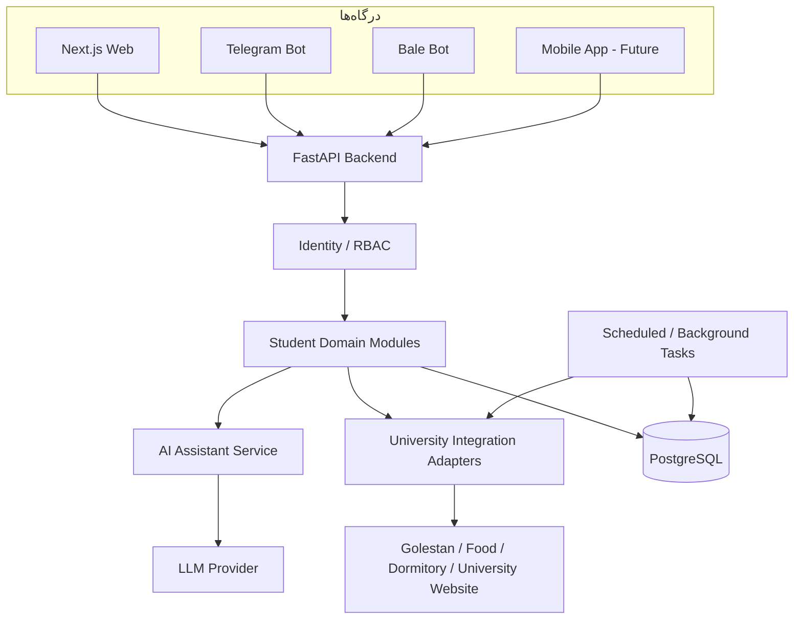
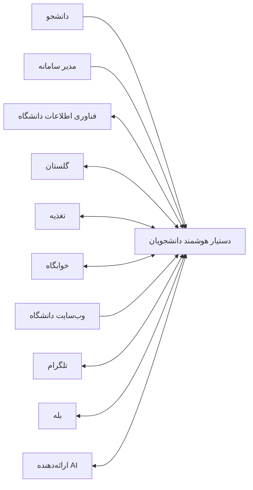
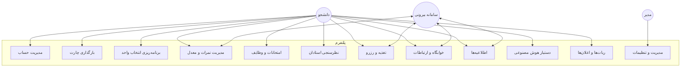
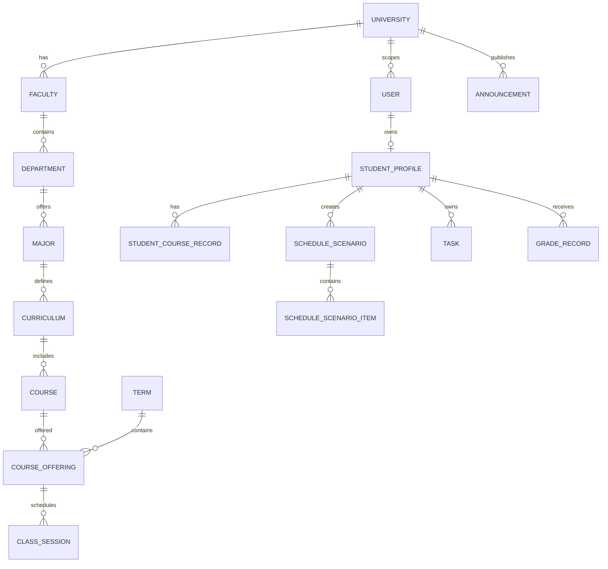
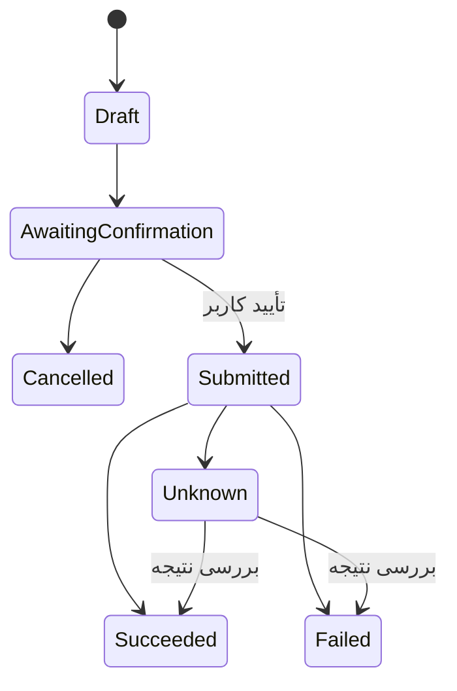

# سند نیازمندی‌های نرم‌افزار (SRS)
## سامانه یکپارچه دستیار هوشمند دانشجویان دانشگاه زنجان
**Zanjan University Smart Student Assistant**

| مشخصه | مقدار |
|---|---|
| شناسه سند | SRS-ZUSSA-1.1 |
| نسخه | 1.1 — نسخه بازطراحی‌شده برای تحویل دانشگاهی در ۶ هفته |
| تاریخ | 2026-11-22 |
| دانشگاه پایلوت | دانشگاه زنجان |
| چشم‌انداز | آغاز از یک دانشگاه و توسعه به دانشگاه‌های دیگر |
| نوع محصول | وب‌اپلیکیشن، API مرکزی، ربات تلگرام و بله |
| زبان | فارسی، راست‌به‌چپ، با پشتیبانی از تقویم شمسی |

> **وضعیت سند:** این سند نیازمندی‌های هدف محصول را مشخص می‌کند. اتصال عملیاتی به گلستان، تغذیه و خوابگاه به بررسی فنی، مجوز و دسترسی مورد تأیید دانشگاه وابسته است؛ درج قابلیت در این سند به معنی قطعی بودن دسترسی نیست.

## فهرست مطالب
1. [پیشگفتار](#1-پیشگفتار)
2. [مقدمه](#2-مقدمه)
3. [واژه‌نامه](#3-واژه‌نامه)
4. [تعریف نیازمندی‌های کاربر](#4-تعریف-نیازمندیهای-کاربر)
5. [معماری سیستم](#5-معماری-سیستم)
6. [مشخصات نیازمندی‌های سیستم](#6-مشخصات-نیازمندیهای-سیستم)
7. [مدل‌های سیستم](#7-مدلهای-سیستم)
8. [تکامل سیستم](#8-تکامل-سیستم)
9. [پیوست‌ها](#9-پیوستها)
  - [پیوست ح: تعریف دقیق تحویل شش‌هفته‌ای](#پیوست-ح-تعریف-دقیق-تحویل-ششهفته‌ای-و-definition-of-done)
10. [نمایه](#10-نمایه)

---

# 1. پیشگفتار

## 1.1 مخاطبان سند

| مخاطب | کاربرد سند |
|---|---|
| استاد درس مهندسی نرم‌افزار | ارزیابی تحلیل، طراحی و ردیابی نیازمندی‌ها |
| مدیران دانشگاه | بررسی ارزش محصول و امکان همکاری |
| معاونت آموزشی و کارشناسان آموزش | بازبینی فرایندهای آموزشی |
| مسئولان تغذیه و خوابگاه | بررسی اتصال‌های رفاهی |
| فناوری اطلاعات دانشگاه | ارزیابی امنیت، دسترسی و میزبانی |
| دانشجویان | بیان نیازها و ارزیابی کاربردپذیری |
| تیم توسعه و آزمون | پیاده‌سازی، آزمون و نگهداری |

## 1.2 تاریخچه نسخه‌ها

| نسخه | تاریخ | شرح |
|---|---|---|
| 0.1 | 2026-11 | ایده اولیه برنامه‌ریز و دستیار تحصیلی |
| 0.5 | 2026-11 | گسترش به امور آموزشی، تغذیه، خوابگاه، اطلاعیه و پیام‌رسان |
| 1.0 | 2026-11-15 | نخستین SRS جامع برای دانشگاه زنجان |
| 1.1 | 2026-11-22 | بازطراحی دامنه، معماری و برنامه تحویل نسخه دانشگاهی در ۶ هفته |

## 1.3 هدف و قراردادهای نگارشی

این سند قرارداد مشترک میان ذی‌نفعان و تیم توسعه است و مشخص می‌کند سامانه چه کاری باید انجام دهد.

- **باید (Shall):** الزام قطعی.
- **بهتر است (Should):** توصیه مهم.
- **می‌تواند (May):** قابلیت اختیاری.
- **ضروری:** برای MVP لازم است؛ **مهم:** برای انتشار بعدی؛ **آتی:** در نقشه راه بلندمدت.

پیشوند شناسه‌ها: `UR` نیازمندی کاربر، `FR` عملکردی، `NFR` غیرعملکردی، `BR` قاعده کسب‌وکار، `INT` یکپارچه‌سازی، `EV` تکامل آینده، `A` فرض، `C` قید، `AT` آزمون پذیرش، `OI` موضوع باز و `R` ریسک.

## 1.4 اصول پایه

1. دانشگاه زنجان دانشگاه پایلوت است.
2. معماری از ابتدا برای افزودن دانشگاه‌های دیگر آماده می‌شود.
3. وب‌اپلیکیشن درگاه اصلی نسخه 1.0 است؛ ربات تلگرام قابلیت تکمیلی و ربات بله در نقشه راه نسخه بعد قرار دارد.
4. همه درگاه‌ها از Backend و هویت مرکزی مشترک استفاده می‌کنند.
5. هوش مصنوعی فقط به داده‌های مجاز همان کاربر دسترسی دارد.
6. عملیات حساس با تأیید کاربر انجام می‌شود.
7. اتصال بیرونی فقط از روش مجاز و مورد تأیید مالک سامانه صورت می‌گیرد.
8. در نبود اتصال بیرونی، ورود دستی یا فایل باید تا حد امکان جایگزین باشد.

---

# 2. مقدمه

## 2.1 بیان مسئله

دانشجویان برای امور روزمره میان سامانه آموزشی، تغذیه، خوابگاه، وب‌سایت دانشگاه، تقویم و پیام‌رسان‌ها جابه‌جا می‌شوند. پراکندگی اطلاعات موجب اتلاف وقت، فراموشی مهلت‌ها و دشواری برنامه‌ریزی می‌شود. این محصول یک نقطه دسترسی یکپارچه برای مدیریت امور دانشجویی ایجاد می‌کند و با کمک هوش مصنوعی، برنامه‌ریزی و انجام عملیات مجاز را ساده می‌سازد.

## 2.2 اهداف محصول

- یکپارچه‌سازی امور آموزشی و برنامه‌ریزی دانشجو.
- دریافت و تحلیل چارت درسی و فایل دروس ارائه‌شده.
- تولید چند سناریوی انتخاب واحد با بررسی تداخل و پیش‌نیاز.
- مدیریت نمرات، معدل، امتحانات، تکالیف و وظایف.
- ایجاد نظرسنجی ساختاریافته درباره تجربه آموزشی استادان.
- مشاهده منوی هفتگی و رزرو غذا در صورت وجود اتصال مجاز.
- تسهیل ارتباط دانشجویان و یافتن دوست، هم‌گروهی یا هم‌اتاقی با رضایت طرفین.
- گردآوری و دسته‌بندی اطلاعیه‌های رسمی دانشگاه.
- دسترسی سریع از طریق ربات تلگرام و بله.
- ارائه دستیار هوش مصنوعی شخصی‌سازی‌شده.
- فراهم کردن زیرساخت توسعه برای دانشگاه‌های دیگر.

## 2.3 دامنه نسخه 1.0 قابل تحویل در شش هفته

نسخه 1.0 یک **نسخه دانشگاهی قابل اجرا و قابل ارزیابی** است، نه نسخه عملیاتی کامل برای کل دانشگاه. هدف آن ارائه یک جریان کامل از ورود دانشجو تا ساخت برنامه تحصیلی، مدیریت کارهای روزانه و مشاهده اطلاعات دانشگاهی است. برای کنترل زمان، از یک Backend یکپارچه، یک وب‌اپلیکیشن و ورودی‌های فایل/دستی استفاده می‌شود.

### 2.3.1 قابلیت‌های الزامی نسخه 1.0 (Must-have)

| شناسه | قابلیت | تعریف دقیق خروجی قابل نمایش |
|---|---|---|
| M1 | حساب و پروفایل | ثبت‌نام، ورود، خروج، پروفایل دانشجو و کنترل دسترسی پایه |
| M2 | چارت درسی | بارگذاری PDF متنی/CSV/Excel در حد قالب توافق‌شده؛ در صورت عدم استخراج مطمئن، فرم ورود و اصلاح دستی؛ پیش‌نمایش و تأیید دانشجو |
| M3 | پرونده آموزشی | ثبت وضعیت گذرانده/درحال‌گذراندن/باقی‌مانده دروس و نمایش پیشرفت |
| M4 | دروس ارائه‌شده | ورود گروه‌ها از CSV/Excel ساده یا فرم دستی شامل کد درس، گروه، استاد، واحد، روز، ساعت و ظرفیت اختیاری |
| M5 | انتخاب واحد هوشمند | بررسی پیش‌نیازهای ثبت‌شده و تداخل زمانی قطعی؛ تولید حداکثر ۳ تا ۵ سناریوی معتبر با امتیاز و توضیح قابل فهم |
| M6 | نمرات و معدل | ثبت دستی نمره و واحد، محاسبه معدل ترمی/کل با فرمول مستند و نمایش منبع داده |
| M7 | امتحانات و وظایف | CRUD امتحان و وظیفه، تقویم ساده و فهرست نزدیک‌ترین مهلت‌ها |
| M8 | داشبورد | نمایش خلاصه نیمسال، پیشرفت، کلاس/امتحان نزدیک، وظایف و اطلاعیه‌ها |
| M9 | اطلاعیه‌ها | پنل ساده ثبت/ویرایش اطلاعیه توسط مدیر و نمایش عنوان، متن، تاریخ و منبع/URL |
| M10 | دستیار AI محدود | پاسخ به پرسش‌های برنامه‌ریزی با زمینه‌ای که کاربر مجاز کرده؛ تولید پیش‌نویس وظیفه/برنامه، بدون اجرای نوشتن تا تأیید |
| M11 | نظرسنجی ساده | فرم بازخورد ساختاریافته برای درس/استاد و نمایش نتایج تجمیعی فقط پس از رسیدن به حداقل پاسخ تعریف‌شده |
| M12 | تغذیه نمایشی/درخواست رزرو | ثبت منوی نمونه یا دستی، انتخاب وعده و ایجاد درخواست رزرو داخلی با وضعیت «در انتظار»؛ بدون ادعای رزرو رسمی |
| M13 | جامعه دانشجویی سبک | پروفایل اختیاری برای یافتن هم‌گروهی/هم‌مطالعه‌ای با فیلدهای حداقلی، رضایت صریح و امکان غیرفعال‌سازی؛ اطلاعات تماس فقط با موافقت دو طرف |
| M14 | ربات تلگرام پایه (هدف تکمیلی) | پیوند امن حساب و چند فرمان خواندنی/یادآوری از طریق API مرکزی؛ در صورت آماده بودن توکن و زمان استقرار؛ در صورت فشار زمان به نسخه 1.1 منتقل می‌شود |
| M15 | پایه چنددانشگاهی | نگهداری شناسه دانشگاه روی داده‌های اصلی و اعمال scope دانشگاه؛ در نسخه تحویلی فقط دانشگاه زنجان فعال است |

### 2.3.2 ساده‌سازی‌های مجاز برای حفظ زمان

- چارت درسی ابتدا با یک یا دو قالب نمونه واقعی دانشگاه زنجان پشتیبانی می‌شود؛ سایر قالب‌ها با ورود دستی پوشش داده می‌شوند.
- موتور انتخاب واحد در نسخه اول یک الگوریتم قطعی و قابل توضیح است؛ استفاده از solver سنگین یا مدل AI برای تصمیم‌گیری الزامی نیست.
- تولید سناریو با محدودیت تعداد ترکیب و تعداد خروجی انجام می‌شود تا زمان اجرا قابل پیش‌بینی بماند.
- اعلان‌ها در نسخه اول درون‌برنامه‌ای هستند؛ ارسال زمان‌بندی‌شده پیامک/ایمیل و صف توزیع‌شده لازم نیست.
- اطلاعیه‌ها می‌توانند توسط مدیر وارد شوند؛ خزنده خودکار وب‌سایت دانشگاه در نسخه اول الزام نیست.
- منوی تغذیه، درخواست رزرو و داده جامعه دانشجویی در محیط خود سامانه مدیریت می‌شوند؛ تا زمان اخذ مجوز، هیچ تراکنش رسمی دانشگاهی انجام نمی‌شود.
- AI فقط از API سمت سرور فراخوانی می‌شود؛ اگر کلید/سرویس AI در دسترس نبود، قابلیت‌های اصلی بدون AI کار می‌کنند.
- ربات تلگرام در صورت فراهم بودن دسترسی در انتهای برنامه ساخته می‌شود؛ رابط بله با قرارداد Adapter طراحی و به فاز بعد منتقل می‌شود.

### 2.3.3 موارد خارج از تحویل عملیاتی نسخه 1.0

- ورود خودکار به گلستان، استخراج خودکار نمرات یا تغییر داده رسمی.
- رزرو قطعی غذا، پرداخت یا لغو رزرو در سامانه رسمی تغذیه.
- خواندن اطلاعات خصوصی خوابگاه یا اتصال به سامانه اسکان.
- ثبت رسمی انتخاب واحد در سامانه دانشگاه.
- اپلیکیشن بومی Android/iOS.
- ربات عملیاتی بله، ارسال پیامک و ایمیل انبوه.
- زیرساخت microservices، Kubernetes، Redis/Celery و مقیاس‌پذیری سازمانی.
- الگوریتم یادگیری ماشین اختصاصی یا آموزش مدل اختصاصی.

این موارد از چشم‌انداز محصول حذف نمی‌شوند؛ در بخش 8 و پیوست ح به‌عنوان توسعه بعدی یا اتصال مشروط ثبت شده‌اند.

## 2.4 دامنه توسعه بعدی

- اتصال مجاز به گلستان برای دریافت نمرات و سوابق.
- اتصال به تغذیه برای مشاهده منو و رزرو.
- اتصال به خوابگاه و امکانات جامعه دانشجویی.
- نظرسنجی استادان با کنترل محرمانگی و کیفیت.
- ربات‌های عملیاتی تلگرام و بله.
- اپلیکیشن موبایل مستقل.
- پشتیبانی عملیاتی از چند دانشگاه.

## 2.5 خارج از دامنه MVP

- جایگزینی سامانه رسمی گلستان یا سامانه‌های دانشگاه.
- تغییر داده رسمی آموزشی بدون مجوز.
- رزرو/پرداخت قطعی بدون تأیید یا اختیار روشن دانشجو.
- افشای اطلاعات خصوصی دانشجویان.
- تضمین یافتن هم‌اتاقی؛ سامانه صرفاً پیشنهاد و ارتباط رضایت‌مندانه فراهم می‌کند.
- تضمین اتصال به سامانه‌ای که API یا مجوز آن هنوز تأیید نشده است.

## 2.6 ذی‌نفعان و نقش‌ها

| ذی‌نفع/نقش | مسئولیت یا علاقه |
|---|---|
| دانشجو | استفاده از امکانات شخصی آموزشی، رفاهی و اجتماعی |
| مدیر سامانه | مدیریت کاربران و تنظیمات فنی |
| مدیر دانشگاه | تنظیم اتصال‌ها و ساختار دانشگاه در صورت اعطای اختیار |
| معاونت آموزشی | صحت اطلاعات آموزشی |
| مسئول تغذیه | قواعد منو و رزرو |
| مسئول خوابگاه | ضوابط و داده‌های مجاز خوابگاهی |
| فناوری اطلاعات | امنیت، مجوز و میزبانی |
| اپراتور محتوا | بررسی اطلاعیه‌ها و گزارش‌ها |
| سرویس یکپارچه‌سازی | ارتباط ماشینی محدود با سامانه‌های بیرونی |

## 2.7 فرضیات

| شناسه | فرض |
|---|---|
| A-1 | دانشگاه پایلوت، دانشگاه زنجان است. |
| A-2 | محصول ابتدا برای یک دانشگاه ارائه می‌شود، اما معماری چنددانشگاهی دارد. |
| A-3 | MVP یک وب‌اپلیکیشن واکنش‌گراست. |
| A-4 | اپ موبایل در فاز بعد با همان API ساخته می‌شود. |
| A-5 | زبان اصلی فارسی و رابط راست‌به‌چپ است. |
| A-6 | تاریخ در رابط شمسی و در ذخیره‌سازی با قالب استاندارد مدیریت می‌شود. |
| A-7 | ورودی اولیه ممکن است PDF، Excel، CSV یا ورود دستی باشد. |
| A-8 | قالب فایل‌های دانشگاه ممکن است تغییر کند؛ بازبینی انسانی لازم است. |
| A-9 | دسترسی سامانه‌های بیرونی هنوز باید بررسی و تأیید شود. |
| A-10 | نظرسنجی باید با سیاست دانشگاه و اصول انصاف سازگار باشد. |
| A-11 | پیوند ربات به حساب اصلی نیازمند احراز مالکیت است. |
| A-12 | رمز سامانه دانشگاهی بدون ضرورت و مجوز رسمی ذخیره نمی‌شود. |
| A-13 | توسعه نسخه دانشگاهی توسط یک توسعه‌دهنده اصلی و در حدود ۲۵ تا ۳۵ ساعت کار متمرکز در هفته انجام می‌شود؛ کاهش ظرفیت باید به بازتنظیم دامنه منجر شود. |

## 2.8 قیود

| شناسه | قید |
|---|---|
| C-1 | رعایت سیاست‌های امنیت و حریم خصوصی دانشگاه الزامی است. |
| C-2 | اتصال بیرونی فقط با روش مجاز انجام می‌شود. |
| C-3 | رزرو تابع محدودیت‌های سامانه رسمی است. |
| C-4 | MVP نباید به اتصال تأییدنشده وابسته باشد. |
| C-5 | کلید API در کد سمت کاربر یا مخزن عمومی قرار نمی‌گیرد. |
| C-6 | منطق اصلی در Backend متمرکز است، نه در ربات‌ها. |

---

# 3. واژه‌نامه

| اصطلاح | تعریف |
|---|---|
| چارت درسی | سند دروس، واحدها، پیش‌نیازها و ساختار برنامه تحصیلی |
| درس ارائه‌شده | درسی که در نیمسال برای انتخاب واحد عرضه شده است |
| گروه درسی | ارائه مشخص یک درس با استاد، زمان و ظرفیت |
| انتخاب واحد | انتخاب درس و گروه مطابق مقررات آموزشی |
| تداخل زمانی | هم‌پوشانی زمان دو کلاس یا رویداد |
| پیش‌نیاز | درسی که گذراندن آن برای اخذ درس دیگر لازم است |
| هم‌نیاز | درسی که باید هم‌زمان یا طبق مقررات اخذ شود |
| گلستان | سامانه آموزشی مورد استفاده دانشگاه |
| سامانه تغذیه | سامانه رسمی منو و رزرو غذا |
| سامانه خوابگاه | سامانه مرتبط با امور اسکان |
| نظرسنجی استاد | فرم ساختاریافته بازخورد درباره تجربه آموزشی |
| تطبیق دانشجو | پیشنهاد ارتباط بر اساس معیارهای اختیاری و رضایت طرفین |
| ربات | رابط مکالمه‌ای تلگرام یا بله |
| دستیار AI | جزء نرم‌افزاری برای فهم درخواست و تولید پاسخ/پیشنهاد |
| Adapter | لایه مستقل اتصال به یک سامانه بیرونی |
| Worker | پردازشگر پس‌زمینه برای اعلان و همگام‌سازی |
| MVP | کمینه محصول پذیرفتنی |
| RBAC | کنترل دسترسی مبتنی بر نقش |
| Audit Log | ثبت رویدادهای مهم برای پیگیری |
| SRS | سند مشخصات نیازمندی‌های نرم‌افزار |

---

# 4. تعریف نیازمندی‌های کاربر

اولویت‌ها: **ضروری** برای MVP، **مهم** برای انتشار بعدی و **آتی** برای توسعه بلندمدت یا مشروط به اتصال.

## 4.1 حساب کاربری و پروفایل

| شناسه | نیازمندی | اولویت |
|---|---|---|
| UR-1.1 | دانشجو بتواند ثبت‌نام و ورود کند. | ضروری |
| UR-1.2 | دانشجو بتواند نام، شماره دانشجویی، رشته، مقطع، ورودی و دانشکده را ثبت/ویرایش کند. | ضروری |
| UR-1.3 | دانشجو بتواند حساب تلگرام و بله را به حساب اصلی پیوند دهد. | مهم |
| UR-1.4 | دانشجو بتواند نشست‌ها و دستگاه‌های متصل را ببیند و لغو کند. | مهم |
| UR-1.5 | بازیابی امن حساب فراهم باشد. | ضروری |

## 4.2 چارت و پرونده آموزشی

| شناسه | نیازمندی | اولویت |
|---|---|---|
| UR-2.1 | دانشجو فایل چارت رشته و ورودی خود را بارگذاری کند. | ضروری |
| UR-2.2 | سامانه دروس، واحد، پیش‌نیاز، هم‌نیاز و دسته را استخراج یا برای ورود دستی آماده کند. | ضروری |
| UR-2.3 | دانشجو داده استخراج‌شده را پیش از ثبت بازبینی و اصلاح کند. | ضروری |
| UR-2.4 | دروس گذرانده، در حال گذراندن و باقی‌مانده نمایش داده شوند. | ضروری |
| UR-2.5 | پیشرفت تحصیلی نمایش داده شود. | مهم |
| UR-2.6 | نمرات ترم‌ها دستی ثبت یا در صورت امکان از گلستان دریافت شوند. | ضروری/اتصال خودکار مهم |
| UR-2.7 | معدل ترمی و کل محاسبه شود. | ضروری |

## 4.3 برنامه‌ریزی انتخاب واحد

| شناسه | نیازمندی | اولویت |
|---|---|---|
| UR-3.1 | دانشجو فایل یا فهرست دروس ارائه‌شده ترم را وارد کند. | ضروری |
| UR-3.2 | گروه‌ها، استاد، زمان، ظرفیت و واحد نمایش داده شوند. | ضروری |
| UR-3.3 | سامانه چند برنامه پیشنهادی انتخاب واحد تولید کند. | ضروری |
| UR-3.4 | تداخل زمانی کلاس‌ها تشخیص داده شود. | ضروری |
| UR-3.5 | پیش‌نیاز و هم‌نیاز بررسی شود. | ضروری |
| UR-3.6 | ترجیحات روز آزاد، ساعت شروع/پایان، استاد و تعداد واحد قابل تعیین باشد. | مهم |
| UR-3.7 | سناریوها از نظر روزهای حضور، ساعات کلاس و تعداد واحد مقایسه شوند. | مهم |
| UR-3.8 | دلیل پیشنهاد یا حذف هر گروه توضیح داده شود. | مهم |
| UR-3.9 | ثبت رسمی در سامانه دانشگاه بدون مجوز و تأیید دانشجو انجام نشود. | ضروری |
| UR-3.10 | سناریوی منتخب ذخیره و خروجی گرفته شود. | ضروری |

## 4.4 نمرات و امتحانات

| شناسه | نیازمندی | اولویت |
|---|---|---|
| UR-4.1 | نمرات به‌صورت دستی ثبت شوند. | ضروری |
| UR-4.2 | در صورت دسترسی مجاز، نمرات از گلستان دریافت شوند. | مهم |
| UR-4.3 | منبع و زمان آخرین به‌روزرسانی نمره دیده شود. | مهم |
| UR-4.4 | جدول امتحانات نمایش داده و مدیریت شود. | ضروری |
| UR-4.5 | تاریخ، ساعت، محل و درس امتحان قابل ثبت/اصلاح باشد. | ضروری |
| UR-4.6 | امتحانات نزدیک در داشبورد و تقویم دیده شوند. | ضروری |
| UR-4.7 | یادآوری امتحان و مهلت آموزشی ارسال شود. | مهم |

## 4.5 نظرسنجی استادان

| شناسه | نیازمندی | اولویت |
|---|---|---|
| UR-5.1 | دانشجو تجربه خود از درس و استاد را با پرسش‌های ساختاریافته ثبت کند. | مهم |
| UR-5.2 | معیارها شامل شیوه تدریس، نظم، شفافیت ارزیابی و دسترس‌پذیری آموزشی باشند. | مهم |
| UR-5.3 | نتایج به‌صورت تجمیعی و با حداقل تعداد پاسخ نمایش داده شوند. | مهم |
| UR-5.4 | گزارش محتوای توهین‌آمیز یا نامرتبط ممکن باشد. | مهم |
| UR-5.5 | هویت پاسخ‌دهنده در خروجی عمومی افشا نشود. | ضروری |
| UR-5.6 | نظرسنجی‌های فعال مرتبط با دروس دانشجو نمایش داده شوند. | مهم |

## 4.6 وظایف و برنامه‌ریزی شخصی

| شناسه | نیازمندی | اولویت |
|---|---|---|
| UR-6.1 | دانشجو وظیفه، تکلیف یا رویداد ایجاد کند. | ضروری |
| UR-6.2 | عنوان، توضیح، مهلت، اولویت و وضعیت تعیین شود. | ضروری |
| UR-6.3 | وظیفه ویرایش، تکمیل یا حذف شود. | ضروری |
| UR-6.4 | کلاس، امتحان و وظیفه در تقویم یکپارچه دیده شوند. | ضروری |
| UR-6.5 | زمان آزاد و بازه مطالعه ثبت شود. | مهم |
| UR-6.6 | برنامه پیشنهادی مطالعه بر اساس مهلت و زمان آزاد ساخته شود. | مهم |
| UR-6.7 | دانشجو بتواند برنامه پیشنهادی را اصلاح یا رد کند. | ضروری |
| UR-6.8 | زمان‌سنج تمرکز و ثبت زمان مطالعه فراهم شود. | مهم |

## 4.7 تغذیه

| شناسه | نیازمندی | اولویت |
|---|---|---|
| UR-7.1 | منوی هفتگی غذا نمایش داده شود. | مهم |
| UR-7.2 | تاریخ، وعده، غذا، قیمت و ظرفیت در صورت دسترسی نمایش داده شود. | مهم |
| UR-7.3 | ترجیحات غذایی و روزهای موردنظر ثبت شوند. | مهم |
| UR-7.4 | پیشنهاد رزرو هفتگی بر اساس ترجیحات ارائه شود. | مهم |
| UR-7.5 | در صورت اتصال مجاز، رزرو از طرف دانشجو انجام شود. | مشروط |
| UR-7.6 | خلاصه سفارش و هزینه پیش از رزرو نمایش داده شود؛ اختیار خودکار محدود باید صریحاً فعال شود. | ضروری |
| UR-7.7 | وضعیت رزرو و نتیجه عملیات قابل مشاهده باشد. | مهم |
| UR-7.8 | مهلت رزرو و لغو یادآوری شود. | مهم |

## 4.8 خوابگاه و جامعه دانشجویی

| شناسه | نیازمندی | اولویت |
|---|---|---|
| UR-8.1 | دانشجو در صورت تمایل اطلاعات مجاز خوابگاهی را ثبت کند. | آتی |
| UR-8.2 | معیارهای اختیاری برای یافتن دوست، هم‌گروهی یا هم‌اتاقی تعیین کند. | آتی |
| UR-8.3 | پیشنهاد تطبیق با رضایت کاربران ارائه شود. | آتی |
| UR-8.4 | اطلاعات تماس فقط با رضایت صاحب آن به اشتراک گذاشته شود. | ضروری |
| UR-8.5 | درخواست ارتباط پذیرفته، رد یا مسدود شود. | آتی |
| UR-8.6 | گزارش رفتار نامناسب فراهم باشد. | آتی |
| UR-8.7 | در صورت مجوز، داده مجاز خوابگاه دریافت شود. | مشروط |

## 4.9 اطلاعیه‌های دانشگاه

| شناسه | نیازمندی | اولویت |
|---|---|---|
| UR-9.1 | آخرین اطلاعیه‌های رسمی دانشگاه مشاهده شوند. | ضروری |
| UR-9.2 | اطلاعیه‌ها بر اساس موضوع، دانشکده، تاریخ و اهمیت دسته‌بندی شوند. | مهم |
| UR-9.3 | منبع اصلی و زمان دریافت هر اطلاعیه نمایش داده شود. | ضروری |
| UR-9.4 | جست‌وجو و ذخیره اطلاعیه ممکن باشد. | مهم |
| UR-9.5 | اطلاعیه مهم و مرتبط اعلان شود. | مهم |
| UR-9.6 | محتوای استخراج‌شده بدون منبع به‌عنوان اطلاعیه رسمی بازنویسی نشود. | ضروری |

## 4.10 ربات تلگرام و بله

| شناسه | نیازمندی | اولویت |
|---|---|---|
| UR-10.1 | حساب تلگرام به حساب سامانه متصل شود. | مهم |
| UR-10.2 | حساب بله به حساب سامانه متصل شود. | مهم |
| UR-10.3 | برنامه روزانه و رویدادهای نزدیک از ربات پرسیده شوند. | مهم |
| UR-10.4 | وظیفه با پیام طبیعی ثبت شود. | مهم |
| UR-10.5 | یادآوری‌های مجاز ارسال شوند. | مهم |
| UR-10.6 | گفتگو با دستیار AI از ربات ممکن باشد. | مهم |
| UR-10.7 | ربات فقط اطلاعات حساب پیوندخورده را نشان دهد. | ضروری |
| UR-10.8 | اتصال ربات قابل لغو باشد. | مهم |

## 4.11 دستیار هوش مصنوعی

| شناسه | نیازمندی | اولویت |
|---|---|---|
| UR-11.1 | دانشجو به زبان طبیعی درباره برنامه و امور خود سؤال کند. | ضروری |
| UR-11.2 | دستیار با مجوز کاربر به وظایف، امتحانات، دروس و تقویم او رجوع کند. | ضروری |
| UR-11.3 | برنامه مطالعه برای امتحان یا تکلیف پیشنهاد شود. | مهم |
| UR-11.4 | درخواست طبیعی به پیش‌نویس وظیفه تبدیل شود. | مهم |
| UR-11.5 | پیش از ایجاد، حذف، تغییر یا رزرو مهم تأیید گرفته شود. | ضروری |
| UR-11.6 | در نبود داده معتبر، عدم قطعیت اعلام شود و اطلاعات ساخته نشود. | ضروری |
| UR-11.7 | اطلاعیه یا یادداشت ثبت‌شده خلاصه شود و منبع ارائه گردد. | مهم |
| UR-11.8 | محدودیت مصرف و هزینه وجود داشته باشد. | مهم |

---

# 5. معماری سیستم

## 5.1 سبک معماری

معماری نسخه 1.0 یک **Modular Monolith** است: یک Backend، یک پایگاه داده و یک وب‌اپلیکیشن. مرز ماژول‌ها در سطح کد حفظ می‌شود، اما سرویس‌ها جداگانه deploy نمی‌شوند. این انتخاب هزینه عملیاتی را برای توسعه‌دهنده تنها کاهش می‌دهد و امکان استخراج سرویس‌ها در آینده را از بین نمی‌برد. ربات‌ها و اتصال‌های بیرونی فقط کلاینت/Adapter همین Backend هستند.

## 5.2 نمای کلی

## 5.3 ماژول‌های منطقی

| ماژول | مسئولیت |
|---|---|
| Identity & Access | ثبت‌نام، ورود، نشست، نقش و پیوند پیام‌رسان |
| Student Profile | مشخصات دانشجو و ترجیحات |
| Academic Structure | دانشگاه، دانشکده، رشته، چارت و درس |
| Curriculum Parser | ورود فایل، استخراج و بازبینی |
| Course Offering | گروه، استاد، زمان و ظرفیت |
| Schedule Optimizer | تولید سناریو و تشخیص تداخل |
| Grades & GPA | نمرات، سوابق و معدل |
| Exams & Calendar | امتحان، رویداد و تقویم |
| Tasks & Study Planner | وظایف، برنامه مطالعه و تمرکز |
| Teacher Feedback | پرسش‌نامه، پاسخ و تجمیع |
| Meal Integration | منو، رزرو و وضعیت عملیات |
| Dormitory & Community | داده مجاز خوابگاه و تطبیق |
| Announcements | دریافت و جست‌وجوی اطلاعیه |
| AI Assistant | فهم درخواست، بازیابی زمینه و اجرای کنترل‌شده |
| Notification | اعلان درون‌برنامه‌ای و پیام‌رسان |
| Integration Gateway | Adapter سامانه‌های بیرونی |
| Admin & Audit | مدیریت و ثبت رویداد |

## 5.4 فناوری‌های پیشنهادی

| لایه | فناوری | دلیل |
|---|---|---|
| وب | Next.js + TypeScript | رابط واکنش‌گرا و اکوسیستم گسترده |
| UI | React و کتابخانه سازگار با RTL | توسعه سریع |
| Backend | Python + FastAPI | API و سازگاری با ابزارهای AI |
| DB | PostgreSQL | داده رابطه‌ای و تراکنش |
| ORM | SQLAlchemy | نگاشت داده |
| Migration | Alembic | نسخه‌بندی DB |
| کارهای پس‌زمینه | FastAPI BackgroundTasks یا دستور زمان‌بندی‌شده ساده | برای حجم MVP؛ بدون صف توزیع‌شده |
| Telegram | Python Telegram Bot framework | اتصال به Bot API |
| Bale | Adapter مبتنی بر API مستند و در دسترس | جداسازی پلتفرم |
| AI | API مدل زبانی با Provider مستقل | تعویض ارائه‌دهنده |
| File Storage | فضای امن فایل/ذخیره‌سازی شیء | نگهداری فایل |
| Test | Pytest و Playwright | آزمون واحد و سرتاسری |
| Deployment | Docker Compose (اختیاری در توسعه، توصیه‌شده برای تحویل) | محیط تکرارپذیر |
| Version Control | Git و GitHub | مدیریت تغییر |
| Design | Figma | طراحی UI/UX |

این فناوری‌ها پیشنهاد اولیه‌اند و پس از بررسی توان تیم، میزبانی و سیاست دانشگاه قابل بازنگری هستند.

## 5.5 اتصال به سامانه‌های بیرونی

آداپتورهای مستقل پیشنهادی: `GolestanAdapter`، `MealAdapter`، `DormitoryAdapter` و `UniversityWebsiteAdapter`.

سیاست اتصال:
1. اولویت با API رسمی و مستند است.
2. هر روش جایگزین باید از نظر مجوز، شرایط استفاده و امنیت تأیید شود.
3. دور زدن CAPTCHA، کنترل امنیتی یا محدودیت دسترسی مجاز نیست.
4. در نبود اتصال، ورود دستی یا فایل حفظ شود.
5. عملیات حساس باید شناسه پیگیری، نتیجه و گزارش خطا داشته باشد.

## 5.6 استقرار نسخه 1.0

- یک سرویس API و یک سرویس Web؛ در صورت استفاده از Next.js می‌توان Web را جدا اجرا کرد.
- PostgreSQL برای محیط تحویل؛ SQLite فقط برای تست سریع محلی مجاز است، نه مرجع نسخه نهایی.
- فایل‌های بارگذاری‌شده در پوشه خصوصی خارج از مسیر public نگهداری شوند.
- تنظیمات از `.env` و نمونه آن از `.env.example` خوانده شود؛ فایل واقعی `.env` وارد Git نشود.
- Docker Compose برای راه‌اندازی تکرارپذیر پیشنهاد می‌شود؛ Kubernetes و زیرساخت ابری پیچیده خارج از دامنه‌اند.
- HTTPS در محیط عمومی الزامی است؛ محیط localhost توسعه می‌تواند HTTP باشد.
- حداقل یک دستور پشتیبان‌گیری و بازیابی DB مستند شود.
- لاگ خطا و Audit برای عملیات حساس ثبت شود؛ سامانه مانیتورینگ توزیع‌شده لازم نیست.

---

# 6. مشخصات نیازمندی‌های سیستم

## 6.1 قواعد کسب‌وکار

| شناسه | قاعده |
|---|---|
| BR-1 | هر داده آموزشی به حساب دانشجو و دانشگاه مربوط است. |
| BR-2 | کاربر داده دانشجوی دیگر را بدون مجوز نمی‌بیند یا تغییر نمی‌دهد. |
| BR-3 | سناریوی انتخاب واحد نباید تداخل زمانی قطعی داشته باشد. |
| BR-4 | پیش‌نیاز و هم‌نیاز مطابق چارت و مقررات معتبر بررسی می‌شوند. |
| BR-5 | داده استخراج‌شده از فایل تا زمان بازبینی قطعی تلقی نمی‌شود. |
| BR-6 | معدل فقط با داده معتبر محاسبه و روش محاسبه مشخص می‌شود. |
| BR-7 | هر نمره منبع، زمان ثبت و وضعیت تأیید دارد. |
| BR-8 | داده بیرونی منبع و زمان آخرین همگام‌سازی دارد. |
| BR-9 | رزرو غذا تابع مجوز، ظرفیت، زمان و قواعد سامانه رسمی است. |
| BR-10 | عملیات دارای هزینه/تعهد پیش از اجرا تأیید می‌خواهد، مگر اختیار محدود خودکار صریحاً فعال باشد. |
| BR-11 | نتیجه نظرسنجی عمومی حداقل تعداد پاسخ لازم را رعایت می‌کند. |
| BR-12 | هویت پاسخ‌دهنده در خروجی عمومی افشا نمی‌شود. |
| BR-13 | اطلاعات تماس یا خوابگاه بدون رضایت به دیگری ارائه نمی‌شود. |
| BR-14 | اطلاعیه منبع و زمان دریافت دارد. |
| BR-15 | AI فقط از داده مجاز کاربر استفاده می‌کند. |
| BR-16 | عملیات مبهم یا حساس AI پیش از اجرا تأیید می‌خواهد. |
| BR-17 | خطای اتصال بیرونی نباید به‌عنوان موفقیت گزارش شود. |
| BR-18 | داده دانشگاه‌ها با شناسه دانشگاه از هم جدا می‌شود. |

## 6.2 نیازمندی‌های عملکردی

### 6.2.1 حساب و دسترسی

| شناسه | نیازمندی سیستم | اولویت |
|---|---|---|
| FR-1.1 | ثبت‌نام و ورود امن فراهم شود. | ضروری |
| FR-1.2 | ورودی‌ها اعتبارسنجی و شناسه‌های یکتا کنترل شوند. | ضروری |
| FR-1.3 | رمز با الگوریتم هش امن و Salt ذخیره شود. | ضروری |
| FR-1.4 | بازیابی امن حساب فراهم شود. | ضروری |
| FR-1.5 | مجوز در سمت سرور و برای هر عملیات بررسی شود. | ضروری |
| FR-1.6 | دانشگاه فعال و وضعیت عضویت کاربر نگهداری شود. | ضروری |
| FR-1.7 | پیوند ربات با کد یک‌بارمصرف و تاریخ انقضا انجام شود. | مهم |
| FR-1.8 | نشست و اتصال پیام‌رسان قابل لغو باشد. | مهم |

### 6.2.2 ورود و پردازش چارت

| شناسه | نیازمندی سیستم | اولویت |
|---|---|---|
| FR-2.1 | PDF، XLSX و CSV مجاز با محدودیت اندازه دریافت شوند. | ضروری |
| FR-2.2 | نوع و سلامت فایل بررسی شود. | ضروری |
| FR-2.3 | داده استخراج‌شده به شکل پیش‌نمایش نمایش داده شود. | ضروری |
| FR-2.4 | عنوان، کد، واحد، پیش‌نیاز و دسته قابل اصلاح باشد. | ضروری |
| FR-2.5 | نسخه و منبع چارت ثبت شود. | مهم |
| FR-2.6 | چارت به دانشگاه، رشته و ورودی متصل شود. | ضروری |
| FR-2.7 | ردیف معتبر، نیازمند بررسی یا ناموفق مشخص شود. | مهم |

### 6.2.3 انتخاب واحد

| شناسه | نیازمندی سیستم | اولویت |
|---|---|---|
| FR-3.1 | دروس و گروه‌های ارائه‌شده قابل ورود/همگام‌سازی باشند. | ضروری |
| FR-3.2 | هر گروه درس، استاد، روز، ساعت، ظرفیت و واحد داشته باشد. | ضروری |
| FR-3.3 | دروس گذرانده و موردنیاز دانشجو مشخص باشند. | ضروری |
| FR-3.4 | تداخل زمانی تشخیص داده شود. | ضروری |
| FR-3.5 | پیش‌نیاز و هم‌نیاز بررسی شود. | ضروری |
| FR-3.6 | چند برنامه معتبر با سقف تعداد سناریو تولید شود. | ضروری |
| FR-3.7 | سناریو بر اساس ترجیحات امتیازدهی شود. | مهم |
| FR-3.8 | دلیل امتیاز و محدودیت‌ها توضیح داده شود. | مهم |
| FR-3.9 | سناریو ذخیره و خروجی‌گیری شود. | ضروری |
| FR-3.10 | زمان آخرین به‌روزرسانی ظرفیت نمایش داده شود. | مهم |
| FR-3.11 | پیشنهاد به‌عنوان ثبت قطعی گلستان معرفی نشود. | ضروری |

### 6.2.4 نمرات و معدل

| شناسه | نیازمندی سیستم | اولویت |
|---|---|---|
| FR-4.1 | نمره با درس، نیمسال، واحد و وضعیت ثبت شود. | ضروری |
| FR-4.2 | اصلاح نمره با تاریخچه تغییرات ممکن باشد. | ضروری |
| FR-4.3 | معدل ترمی از داده معتبر محاسبه شود. | ضروری |
| FR-4.4 | معدل کل بر اساس سوابق تأییدشده محاسبه شود. | ضروری |
| FR-4.5 | نمره بیرونی با منبع و زمان همگام‌سازی ثبت شود. | مهم |
| FR-4.6 | اختلاف داده دستی و بیرونی برای بررسی نشان داده شود. | مهم |
| FR-4.7 | داده ناقص از محاسبه قطعی کنار گذاشته و دلیل اعلام شود. | ضروری |

### 6.2.5 تقویم و وظایف

| شناسه | نیازمندی سیستم | اولویت |
|---|---|---|
| FR-5.1 | ایجاد، ویرایش و حذف امتحان و رویداد فراهم شود. | ضروری |
| FR-5.2 | تاریخ در UI شمسی و در DB استاندارد باشد. | ضروری |
| FR-5.3 | وظیفه عنوان، مهلت، اولویت و وضعیت داشته باشد. | ضروری |
| FR-5.4 | کلاس، امتحان و وظیفه در تقویم یکپارچه نمایش داده شوند. | ضروری |
| FR-5.5 | یادآوری قابل تنظیم باشد. | مهم |
| FR-5.6 | اعلان تکراری ناخواسته ایجاد نشود. | مهم |
| FR-5.7 | منطقه زمانی درست مدیریت شود. | ضروری |

### 6.2.6 نظرسنجی استادان

| شناسه | نیازمندی سیستم | اولویت |
|---|---|---|
| FR-6.1 | مدیر مجاز دوره و پرسش‌نامه تعریف کند. | مهم |
| FR-6.2 | پرسش‌ها معیارهای روشن و غیرتوهین‌آمیز داشته باشند. | مهم |
| FR-6.3 | ثبت پاسخ تکراری مطابق سیاست دوره کنترل شود. | مهم |
| FR-6.4 | پاسخ از هویت کاربر جدا یا محافظت‌شده نگهداری شود. | ضروری |
| FR-6.5 | نتیجه فقط پس از رسیدن به حداقل پاسخ نمایش داده شود. | ضروری |
| FR-6.6 | گزارش تخلف و رسیدگی مدیریتی فراهم شود. | مهم |
| FR-6.7 | محتوای افشاگرانه یا آزاردهنده علامت‌گذاری/مسدود شود. | مهم |

### 6.2.7 تغذیه

| شناسه | نیازمندی سیستم | اولویت |
|---|---|---|
| FR-7.1 | منو با تاریخ، وعده و منبع نمایش داده شود. | مهم |
| FR-7.2 | ترجیحات و بودجه اختیاری نگهداری شوند. | مهم |
| FR-7.3 | پیشنهاد رزرو بر اساس ترجیحات تولید شود. | مهم |
| FR-7.4 | روز، وعده، هزینه و محدودیت پیش از رزرو نمایش داده شود. | ضروری |
| FR-7.5 | نتیجه موفق، ناموفق یا نامشخص ثبت شود. | مهم |
| FR-7.6 | درخواست رزرو تکراری ناخواسته کنترل شود. | ضروری |
| FR-7.7 | ورود دستی منو در نبود اتصال ممکن باشد. | مهم |
| FR-7.8 | لغو رزرو تابع مهلت رسمی باشد. | مهم |

### 6.2.8 خوابگاه و جامعه

| شناسه | نیازمندی سیستم | اولویت |
|---|---|---|
| FR-8.1 | تنظیمات حریم خصوصی پروفایل اجتماعی فراهم شود. | آتی |
| FR-8.2 | معیار تطبیق اختیاری و قابل ویرایش باشد. | آتی |
| FR-8.3 | پیشنهاد ارتباط بدون افشای اطلاعات خصوصی اولیه ارائه شود. | آتی |
| FR-8.4 | درخواست، پذیرش، رد و مسدودسازی پشتیبانی شود. | آتی |
| FR-8.5 | گزارش رفتار نامناسب فراهم شود. | آتی |
| FR-8.6 | اتصال خوابگاه با حداقل داده و مجوز انجام شود. | مشروط |

### 6.2.9 اطلاعیه‌ها

| شناسه | نیازمندی سیستم | اولویت |
|---|---|---|
| FR-9.1 | منابع رسمی در تنظیمات نگهداری شوند. | ضروری |
| FR-9.2 | اطلاعیه جدید طبق زمان‌بندی دریافت شود. | مهم |
| FR-9.3 | عنوان، متن، دسته، تاریخ، منبع و URL ذخیره شود. | ضروری |
| FR-9.4 | اطلاعیه تکراری شناسایی شود. | مهم |
| FR-9.5 | جست‌وجو و فیلتر فراهم شود. | مهم |
| FR-9.6 | خطا و آخرین دریافت موفق ثبت شود. | مهم |

### 6.2.10 پیام‌رسان و اعلان

| شناسه | نیازمندی سیستم | اولویت |
|---|---|---|
| FR-10.1 | Adapter مستقل برای هر پیام‌رسان وجود داشته باشد. | مهم |
| FR-10.2 | پیوند حساب با کد یک‌بارمصرف انجام شود. | مهم |
| FR-10.3 | ربات درخواست را به API مرکزی بفرستد. | ضروری |
| FR-10.4 | فقط داده مجاز کاربر ارسال شود. | ضروری |
| FR-10.5 | اعلان صف‌شده و وضعیت ارسال نگهداری شود. | مهم |
| FR-10.6 | خطا و تلاش مجدد کنترل شود. | مهم |
| FR-10.7 | نوع اعلان و کانال قابل تنظیم باشد. | مهم |

### 6.2.11 هوش مصنوعی

| شناسه | نیازمندی سیستم | اولویت |
|---|---|---|
| FR-11.1 | درخواست طبیعی به قصد و پارامتر قابل بررسی تبدیل شود. | ضروری |
| FR-11.2 | داده مرتبط و مجاز همان کاربر بازیابی شود. | ضروری |
| FR-11.3 | در نبود داده، محدودیت اعلام یا سؤال روشن‌کننده پرسیده شود. | ضروری |
| FR-11.4 | عملیات نوشتن فقط از ابزارهای Backend اعتبارسنجی‌شده انجام شود. | ضروری |
| FR-11.5 | عملیات حساس پیش‌نمایش و تأیید داشته باشد. | ضروری |
| FR-11.6 | تاریخچه AI طبق سیاست نگهداری مدیریت شود. | مهم |
| FR-11.7 | سقف مصرف و هزینه اعمال شود. | مهم |
| FR-11.8 | اسرار و داده غیرضروری به مدل ارسال نشود. | ضروری |
| FR-11.9 | ارائه‌دهنده مدل قابل تعویض باشد. | مهم |
| FR-11.10 | خروجی AI جایگزین مرجع رسمی دانشگاه نباشد. | ضروری |

## 6.3 نیازمندی‌های غیرعملکردی

### امنیت و حریم خصوصی

| شناسه | نیازمندی | معیار |
|---|---|---|
| NFR-SEC1 | ارتباطات عملیاتی با HTTPS رمزنگاری شوند. | هیچ endpoint حساس بدون TLS |
| NFR-SEC2 | رمز با هش امن و Salt ذخیره شود. | متن خام رمز در DB/لاگ نباشد |
| NFR-SEC3 | کنترل دسترسی در سمت سرور باشد. | آزمون دسترسی بین حساب‌ها موفق |
| NFR-SEC4 | ورودی و خروجی در برابر تزریق و XSS ایمن شوند. | آزمون امنیتی مسیرهای اصلی |
| NFR-SEC5 | کلیدها در مخزن یا کلاینت قرار نگیرند. | اسکن مخزن |
| NFR-SEC6 | داده دانشگاه‌ها جداسازی شود. | آزمون چنددانشگاهی |
| NFR-SEC7 | عملیات حساس در Audit Log ثبت شوند. | عامل، زمان، نوع و نتیجه |
| NFR-SEC8 | فایل از نظر نوع، اندازه و محتوای خطرناک بررسی شود. | فایل غیرمجاز رد شود |
| NFR-SEC9 | فقط داده ضروری جمع‌آوری و نگهداری شود. | سیاست حذف و نگهداری |
| NFR-SEC10 | داده نظرسنجی و جامعه با محرمانگی ویژه محافظت شود. | عدم افشای هویت و اطلاعات خصوصی |

### کارایی

| شناسه | نیازمندی | معیار هدف اولیه |
|---|---|---|
| NFR-PERF1 | API عادی پاسخ سریع بدهد. | صدک 95 کمتر از 2 ثانیه در بار پایلوت، بدون سرویس بیرونی |
| NFR-PERF2 | پردازش فایل غیرمسدودکننده باشد. | وضعیت پردازش نمایش داده شود |
| NFR-PERF3 | تولید سناریو محدودیت زمان و تعداد خروجی داشته باشد. | نتیجه معمول در چند ثانیه برای داده پایلوت |
| NFR-PERF4 | اعلان و همگام‌سازی در Worker انجام شود. | درخواست کاربر منتظر صف نماند |

### قابلیت اطمینان و نگهداری

| شناسه | نیازمندی |
|---|---|
| NFR-REL1 | خطای سامانه بیرونی کل محصول را از کار نیندازد. |
| NFR-REL2 | عملیات حساس در برابر اجرای تکراری محافظت شوند. |
| NFR-REL3 | داده اصلی پشتیبان‌گیری و بازیابی آن آزموده شود. |
| NFR-REL4 | زمان آخرین همگام‌سازی و نتیجه ثبت شود. |
| NFR-REL5 | شکست اعلان موجب گم شدن رویداد نشود. |
| NFR-MNT1 | کد به ماژول‌های دامنه‌ای تقسیم شود. |
| NFR-MNT2 | اتصال بیرونی پشت Interface/Adapter باشد. |
| NFR-MNT3 | API نسخه‌گذاری‌پذیر باشد. |
| NFR-MNT4 | تغییر DB با Migration مدیریت شود. |
| NFR-MNT5 | منطق اصلی آزمون واحد و یکپارچه داشته باشد. |
| NFR-MNT6 | مستندات API به‌روز تولید شوند. |
| NFR-MNT7 | تنظیمات محیطی در کد ثابت نباشند. |

### تجربه کاربری و سازگاری

| شناسه | نیازمندی |
|---|---|
| NFR-UX1 | رابط فارسی و RTL باشد. |
| NFR-UX2 | رابط در موبایل، تبلت و دسکتاپ واکنش‌گرا باشد. |
| NFR-UX3 | تاریخ شمسی و منطقه زمانی روشن نمایش داده شود. |
| NFR-UX4 | خطاها روشن و همراه راهکار باشند. |
| NFR-UX5 | وضعیت عملیات طولانی نمایش داده شود. |
| NFR-UX6 | عملیات حساس پیش از اجرا خلاصه و قابل لغو باشند. |
| NFR-COMP1 | وب‌اپ در مرورگرهای مدرن کار کند. |
| NFR-COMP2 | افزودن دانشگاه جدید نیازمند کپی کامل برنامه نباشد. |
| NFR-COMP3 | ساختار و آداپتور هر دانشگاه قابل پیکربندی باشد. |
| NFR-COMP4 | داده دانشگاه‌ها در API و DB جدا باشد. |
| NFR-COMP5 | تغییر سامانه یک دانشگاه اتصال دانشگاه دیگر را مختل نکند. |

## 6.4 نیازمندی‌های یکپارچه‌سازی

| شناسه | سامانه | داده/عملیات | پیش‌شرط |
|---|---|---|---|
| INT-1 | گلستان | نمرات، سوابق و اطلاعات آموزشی مجاز | مجوز و روش اتصال |
| INT-2 | تغذیه | منو، ظرفیت، رزرو و وضعیت | دسترسی رسمی/تأییدشده |
| INT-3 | خوابگاه | اطلاعات مجاز اسکان | موافقت مسئول و رضایت دانشجو |
| INT-4 | سایت دانشگاه | اطلاعیه و منبع اصلی | رعایت شرایط استفاده |
| INT-5 | Telegram | پیام، پیوند و اعلان | ساخت ربات |
| INT-6 | Bale | پیام و اعلان | API و دسترسی معتبر |
| INT-7 | AI Provider | پاسخ و تحلیل درخواست | کلید، سیاست داده و بودجه |

هر Adapter باید وضعیت اتصال، آخرین همگام‌سازی موفق، شناسه عملیات، خطای قابل فهم، Timeout، Retry، Rate Limit و Audit را پشتیبانی کند.

---

# 7. مدل‌های سیستم

## 7.1 نمودار زمینه

## 7.2 بازیگران و موارد کاربرد

| بازیگر | موارد کاربرد |
|---|---|
| دانشجو | حساب، چارت، انتخاب واحد، نمرات، امتحان، وظایف، نظرسنجی، تغذیه، خوابگاه، اطلاعیه، AI و ربات |
| مدیر سامانه | مدیریت کاربران و تنظیمات |
| مدیر دانشگاه | پیکربندی ساختار و اتصال‌ها |
| اپراتور محتوا | بررسی اطلاعیه و گزارش‌ها |
| سامانه بیرونی | تبادل داده از طریق Adapter |

## 7.3 نمودار موارد کاربرد سطح بالا

## 7.4 جریان‌های اصلی

### 7.4.1 بارگذاری چارت
1. دانشجو وارد حساب می‌شود.
2. رشته، ورودی و نوع چارت را انتخاب می‌کند.
3. فایل را بارگذاری می‌کند.
4. سامانه فایل را اعتبارسنجی و پردازش می‌کند.
5. داده استخراج‌شده به شکل پیش‌نمایش نمایش داده می‌شود.
6. دانشجو موارد نامطمئن را اصلاح می‌کند.
7. چارت ذخیره و به پرونده تحصیلی متصل می‌شود.

### 7.4.2 تولید برنامه انتخاب واحد
1. دانشجو نیمسال را انتخاب می‌کند.
2. دروس ارائه‌شده وارد یا همگام می‌شوند.
3. سامانه دروس باقی‌مانده را با چارت و سوابق تطبیق می‌دهد.
4. ترجیحات و محدودیت‌ها تعیین می‌شوند.
5. ترکیب‌های معتبر تولید و از نظر تداخل و پیش‌نیاز بررسی می‌شوند.
6. چند سناریو با تفاوت‌ها و امتیازها نمایش داده می‌شود.
7. دانشجو سناریو را ذخیره می‌کند.
8. ثبت رسمی در گلستان، در صورت امکان، مرحله‌ای جدا و نیازمند مجوز و تأیید است.

### 7.4.3 دریافت نمرات
1. دانشجو درخواست همگام‌سازی می‌دهد.
2. اتصال و مجوز بررسی می‌شود.
3. Adapter درخواست را ارسال می‌کند.
4. داده دریافتی اعتبارسنجی می‌شود.
5. داده جدید با سابقه مقایسه می‌شود.
6. اختلاف‌ها برای بررسی نمایش داده می‌شوند.
7. منبع و زمان همگام‌سازی ثبت می‌شود.

### 7.4.4 رزرو غذا
1. منوی هفتگی دریافت یا دستی وارد می‌شود.
2. ترجیحات و روزها تعیین می‌شوند.
3. پیشنهاد رزرو ساخته می‌شود.
4. خلاصه غذا، هزینه و محدودیت نمایش داده می‌شود.
5. دانشجو تأیید می‌کند یا اختیار خودکار محدود را فعال می‌سازد.
6. درخواست از Adapter ارسال می‌شود.
7. نتیجه و شناسه پیگیری نمایش داده می‌شود.
8. در وضعیت نامشخص، موفقیت کاذب گزارش نمی‌شود.

### 7.4.5 ثبت وظیفه با AI
1. دانشجو درخواست طبیعی ارسال می‌کند.
2. AI قصد و پارامترها را استخراج می‌کند.
3. تاریخ نسبی تفسیر می‌شود.
4. پیش‌نویس وظیفه نمایش داده می‌شود.
5. دانشجو تأیید یا اصلاح می‌کند.
6. Backend وظیفه را ثبت می‌کند.
7. نتیجه اعلام می‌شود.

### 7.4.6 دریافت اطلاعیه
1. Worker منبع رسمی را بررسی می‌کند.
2. محتوای جدید استخراج و تکراری‌ها شناسایی می‌شوند.
3. عنوان، متن، منبع، URL و زمان دریافت ذخیره می‌شوند.
4. اطلاعیه دسته‌بندی می‌شود.
5. اعلان مرتبط طبق تنظیمات ارسال می‌شود.

## 7.5 موجودیت‌های اصلی داده

| موجودیت | ویژگی‌های کلیدی |
|---|---|
| `University` | شناسه، نام، دامنه و تنظیمات |
| `Faculty` / `Department` | دانشگاه، نام و کد |
| `Major` | رشته، مقطع و دانشکده |
| `User` | شناسه، اطلاعات ورود و وضعیت |
| `StudentProfile` | شماره دانشجویی، رشته، ورودی و مقطع |
| `MessengerAccount` | کاربر، پلتفرم و شناسه خارجی |
| `Curriculum` | رشته، ورودی، نسخه و منبع |
| `Course` | کد، عنوان، واحد و نوع |
| `CoursePrerequisite` | رابطه پیش‌نیاز/هم‌نیاز |
| `StudentCourseRecord` | دانشجو، درس، نیمسال و وضعیت |
| `Term` | سال تحصیلی و نیمسال |
| `CourseOffering` | درس، استاد، گروه و ظرفیت |
| `ClassSession` | گروه، روز، ساعت و مکان |
| `ScheduleScenario` / `ScheduleScenarioItem` | سناریو و گروه‌های منتخب |
| `GradeRecord` | دانشجو، درس، نمره، منبع و تأیید |
| `Exam` | درس، زمان و مکان |
| `Task` / `CalendarEvent` | دانشجو، عنوان، مهلت و نوع |
| `Teacher` / `TeacherSurvey` / `SurveyResponse` | استاد، پرسش‌نامه و پاسخ |
| `MealMenuItem` / `MealReservation` | منو و رزرو |
| `DormitoryProfile` / `MatchPreference` | داده مجاز و معیار تطبیق |
| `ConnectionRequest` | فرستنده، گیرنده و وضعیت |
| `Announcement` | عنوان، متن، منبع و تاریخ |
| `AIConversation` / `AIMessage` | گفتگو و پیام |
| `Notification` | کاربر، کانال و وضعیت |
| `IntegrationConfig` / `SyncRun` | تنظیم اتصال و سابقه همگام‌سازی |
| `AuditLog` | عامل، عملیات، زمان و نتیجه |

## 7.6 روابط کلیدی

## 7.7 وضعیت عملیات رزرو

---

# 8. تکامل سیستم

## 8.1 راهبرد انتشار

نسخه 1.0 در بازه شش هفته برای یک توسعه‌دهنده و با اولویت تحویل قابل نمایش ساخته می‌شود. همه قابلیت‌های محصول در SRS حفظ شده‌اند، اما عمق پیاده‌سازی آن‌ها متفاوت است: قابلیت‌های هسته به‌صورت واقعی، برخی قابلیت‌های جانبی به‌صورت نسخه سبک داخلی، و اتصال‌های بیرونی از طریق Adapter و وضعیت غیرفعال تا زمان مجوز ارائه می‌شوند.

## 8.2 نقشه راه محصول

| نسخه/فاز | خروجی | وضعیت |
|---|---|---|
| 1.0-A | هسته حساب، پروفایل، چارت، پرونده آموزشی، ورود دروس و انتخاب واحد | تحویل شش‌هفته‌ای |
| 1.0-B | نمرات دستی، معدل، امتحان، وظایف، تقویم و داشبورد | تحویل شش‌هفته‌ای |
| 1.0-C | اطلاعیه دستی، نظرسنجی ساده، منوی نمونه/درخواست رزرو داخلی، جامعه دانشجویی opt-in | نسخه سبک تحویلی |
| 1.0-D | AI محدود و ربات تلگرام پایه، مشروط به دسترسی و زمان | هدف انتهای شش هفته؛ اولویت پس از هسته |
| 1.1 | تکمیل ربات تلگرام، ربات بله، اعلان‌های زمان‌بندی‌شده، import قالب‌های بیشتر | بعد از تحویل |
| 1.2 | اتصال مجاز به گلستان، تغذیه و خوابگاه پس از تأیید فنی/حقوقی | مشروط |
| 2.0 | اپ موبایل، چنددانشگاهی عملیاتی، گزارش‌گیری پیشرفته و مقیاس‌پذیری | توسعه محصول |

## 8.3 برنامه اجرایی شش هفته‌ای

برنامه زیر برای **یک توسعه‌دهنده با حدود ۲۵ تا ۳۵ ساعت کار متمرکز در هفته** تنظیم شده است. زمان‌ها شامل پیاده‌سازی، تست و اصلاح هستند. اگر زمان واقعی کمتر باشد، ابتدا قابلیت‌های «نسخه سبک» باید به حالت ثبت/نمایش ساده محدود شوند، نه اینکه کیفیت هسته و امنیت کاهش یابد.

| هفته | تمرکز | کارهای دقیق | خروجی قابل ارائه / معیار پایان |
|---|---|---|---|
| هفته ۱ | پایه و زیرساخت | تثبیت نیازمندی‌ها؛ ساخت مخزن؛ راه‌اندازی Next.js و FastAPI؛ PostgreSQL و Alembic؛ تنظیمات؛ مدل User/University/StudentProfile؛ ثبت‌نام/ورود؛ layout فارسی RTL | برنامه بالا بیاید؛ migration اجرا شود؛ دانشجو ثبت‌نام و وارد شود؛ دسترسی endpoint خصوصی بدون توکن رد شود |
| هفته ۲ | چارت و پرونده آموزشی | آپلود امن فایل؛ پشتیبانی از CSV/Excel و PDF متنی در حد قالب نمونه؛ preview و اصلاح دستی؛ مدل Course/Curriculum/Prerequisite؛ وضعیت دروس و پیشرفت | دانشجو چارت را وارد، اصلاح و تأیید کند؛ داده پس از restart باقی بماند |
| هفته ۳ | ارائه‌ها و انتخاب واحد | ورود گروه‌ها از CSV/فرم؛ زمان‌بندی جلسات؛ بررسی پیش‌نیاز؛ تشخیص هم‌پوشانی؛ تولید حداکثر ۳ تا ۵ سناریو؛ مقایسه و ذخیره سناریو | داده نمونه واقعی؛ سناریوهای معتبر؛ تست خودکار برای تداخل و پیش‌نیاز؛ خروجی قابل چاپ/دانلود |
| هفته ۴ | سوابق و مدیریت زمان | ثبت نمرات؛ محاسبه معدل؛ امتحانات؛ وظایف؛ تقویم؛ داشبورد؛ اطلاعیه دستی مدیر | جریان اصلی دانشجو از داشبورد تا نمره/امتحان/وظیفه کار کند؛ آزمون پذیرش هسته پاس شود |
| هفته ۵ | قابلیت‌های مکمل | AI محدود با ابزارهای مجاز و تأیید عملیات؛ نظرسنجی ساده با تجمیع امن؛ منوی تغذیه و درخواست داخلی؛ پروفایل اجتماعی اختیاری؛ Adapterهای غیرفعال/نمونه برای گلستان، تغذیه و خوابگاه | قابلیت‌های مکمل قابل نمایش باشند؛ هیچ عملیات آزمایشی به‌عنوان عملیات رسمی جا زده نشود؛ کنترل حریم خصوصی تست شود |
| هفته ۶ | یکپارچه‌سازی و تحویل | ربات تلگرام پایه در صورت آماده بودن توکن؛ وضعیت Adapterها؛ رفع باگ؛ تست end-to-end؛ امنیت و مجوزها؛ seed داده نمایشی برچسب‌خورده؛ راهنمای نصب؛ ویدیوی demo و مستندات | نصب از صفر طبق README؛ اجرای سناریوهای پذیرش؛ نسخه پایدار demo؛ فهرست محدودیت‌ها و کارهای آتی |

### 8.3.1 اولویت‌بندی در صورت عقب‌افتادن برنامه

1. **هرگز حذف نشود:** امنیت پایه، مالکیت داده، چارت/پرونده، ورود دروس، تداخل‌یابی و انتخاب واحد، نمرات/معدل، امتحان و وظیفه، تست و راهنمای اجرا.
2. **به نسخه سبک تقلیل یابد:** استخراج PDF به ورود CSV/فرم؛ AI به تولید پیش‌نویس؛ اطلاعیه به ورود دستی؛ تغذیه به منو و درخواست داخلی؛ جامعه به پروفایل opt-in ساده؛ نظرسنجی به فرم و نتیجه تجمیعی.
3. **به 1.1 منتقل شود:** ربات بله، خزنده خودکار وب‌سایت، اعلان زمان‌بندی‌شده چندکاناله، قالب‌های متعدد فایل و اتصال‌های واقعی دانشگاه.
4. **به هیچ وجه برای نمایش نهایی جعل نشود:** اتصال گلستان، رزرو رسمی غذا، دسترسی خوابگاه یا ثبت رسمی انتخاب واحد.

### 8.3.2 فرض‌های زمان‌بندی و محدودیت ظرفیت

- یک توسعه‌دهنده اصلی؛ بدون تیم جداگانه QA، DevOps یا طراح تمام‌وقت.
- استاد/دانشگاه باید نمونه فایل چارت و دروس ارائه‌شده را در ابتدای هفته اول فراهم کند.
- کلید AI و توکن ربات، در صورت نیاز، باید پیش از هفته پنجم آماده باشد.
- تغییرات عمده در نیازمندی‌ها پس از پایان هفته دوم وارد نسخه 1.1 می‌شوند.
- این برنامه تخمین مهندسی است، نه تضمین قطعی؛ تأخیر در داده نمونه، دسترسی یا بازخورد استاد ریسک زمان‌بندی دارد.

## 8.4 قابلیت‌های آینده

- **گلستان:** دریافت خودکار نمرات و سوابق، تشخیص تغییرات و ثبت زمان همگام‌سازی.
- **تغذیه:** پیشنهاد هفتگی، ترجیحات و رزرو زمان‌بندی‌شده در محدوده مجوز.
- **خوابگاه:** تطبیق دوست/هم‌گروهی/هم‌اتاقی، گروه مطالعه و کنترل ایمنی.
- **موبایل:** React Native یا فناوری هم‌ارز، Push Notification و استفاده از API مشترک.
- **چنددانشگاهی:** تنظیم ساختار، آداپتور، تقویم و سیاست مستقل هر دانشگاه.

## 8.5 موارد غیرقطعی تا زمان تأیید

1. ورود خودکار به گلستان و استخراج نمرات.
2. رزرو قطعی غذا در سامانه تغذیه.
3. دریافت داده خصوصی خوابگاه.
4. عملیات دارای هزینه بدون تأیید یا اختیار رسمی.
5. استخراج از منابعی که شرایط استفاده و دسترسی آن‌ها روشن نیست.

---

# 9. پیوست‌ها

## پیوست الف: ماتریس ردیابی

| نیازمندی کاربر | نیازمندی سیستم | ماژول | معیار پذیرش |
|---|---|---|---|
| UR-1 حساب | FR-1.x | Identity/Profile | ثبت‌نام، ورود و کنترل دسترسی |
| UR-2 چارت | FR-2.x | Curriculum | استخراج، پیش‌نمایش و اصلاح |
| UR-3 انتخاب واحد | FR-3.x | Optimizer | سناریوی معتبر بدون تداخل قطعی |
| UR-4 نمره/امتحان | FR-4.x، FR-5.x | Academic/Calendar | ثبت سابقه و نمایش امتحان |
| UR-5 نظرسنجی | FR-6.x | Feedback | محرمانگی و تجمیع امن |
| UR-6 وظایف | FR-5.x | Task Planner | ایجاد، ویرایش و یادآوری |
| UR-7 تغذیه | FR-7.x | Meal Adapter | منو و وضعیت عملیات |
| UR-8 خوابگاه | FR-8.x | Community | رضایت و حریم خصوصی |
| UR-9 اطلاعیه | FR-9.x | Announcements | منبع و زمان دریافت |
| UR-10 ربات | FR-10.x | Messaging | پیوند و پاسخ مجاز |
| UR-11 AI | FR-11.x | AI Assistant | پاسخ زمینه‌مند و تأیید عملیات |

## پیوست ب: آزمون‌های پذیرش

| شناسه | سناریو | نتیجه مورد انتظار |
|---|---|---|
| AT-01 | ثبت‌نام معتبر | حساب ایجاد شود. |
| AT-02 | ورود با رمز اشتباه | ورود رد شود. |
| AT-03 | مشاهده داده دانشجوی دیگر | دسترسی رد شود. |
| AT-04 | فایل با قالب نامعتبر | فایل رد و قالب مجاز اعلام شود. |
| AT-05 | بارگذاری چارت معتبر | پیش‌نمایش و اصلاح فراهم باشد. |
| AT-06 | ردیف ناقص چارت | برای بررسی علامت‌گذاری شود. |
| AT-07 | انتخاب دو گروه هم‌زمان | تداخل تشخیص داده شود. |
| AT-08 | درس فاقد پیش‌نیاز | هشدار/منع مطابق قاعده اعمال شود. |
| AT-09 | تولید سناریو | چند برنامه معتبر ارائه شود. |
| AT-10 | ثبت نمره دستی | منبع و زمان ذخیره شود. |
| AT-11 | معدل با داده ناقص | محدودیت محاسبه توضیح داده شود. |
| AT-12 | ثبت امتحان | در تقویم و داشبورد دیده شود. |
| AT-13 | ایجاد وظیفه | در فهرست و تقویم نمایش داده شود. |
| AT-14 | درخواست AI برای وظیفه | پیش‌نویس برای تأیید نمایش داده شود. |
| AT-15 | AI بدون داده کافی | عدم قطعیت اعلام شود. |
| AT-16 | رزرو غذا بدون تأیید | اجرا نشود. |
| AT-17 | خطای تغذیه | موفقیت کاذب گزارش نشود. |
| AT-18 | نظرسنجی زیر حداقل پاسخ | نتیجه عمومی نمایش داده نشود. |
| AT-19 | پروفایل اجتماعی خصوصی | اطلاعات افشا نشود. |
| AT-20 | نمایش اطلاعیه | منبع و URL موجود باشد. |
| AT-21 | پیوند ربات با کد منقضی | پیوند رد شود. |
| AT-22 | اعلان تکراری | از تکرار ناخواسته جلوگیری شود. |
| AT-23 | قطع گلستان | سایر ماژول‌ها فعال بمانند. |
| AT-24 | افزودن دانشگاه دوم آزمایشی | داده دو دانشگاه جدا بماند. |

## پیوست ج: ریسک‌ها و راهکارها

| شناسه | ریسک | اثر | راهکار |
|---|---|---|---|
| R-1 | نبود API/مجوز گلستان | بالا | امکان‌سنجی زودهنگام و ورود دستی |
| R-2 | تغییر سامانه بیرونی | بالا | Adapter مستقل و پایش |
| R-3 | خطای استخراج چارت | متوسط/بالا | پیش‌نمایش و تأیید انسانی |
| R-4 | پیشنهاد اشتباه انتخاب واحد | بالا | قواعد صریح و عدم ثبت خودکار |
| R-5 | افشای داده دانشجو | بسیار بالا | RBAC، رمزنگاری و ممیزی |
| R-6 | سوءاستفاده در نظرسنجی | بالا | حداقل پاسخ و مدیریت محتوا |
| R-7 | رزرو تکراری/اشتباه | بالا | تأیید و Idempotency |
| R-8 | تطبیق اجتماعی نامناسب | بالا | رضایت، مسدودسازی و گزارش |
| R-9 | هزینه AI | متوسط | سقف مصرف و Provider مستقل |
| R-10 | تغییر API پیام‌رسان | متوسط | Adapter مستقل |
| R-11 | بزرگ شدن دامنه | بالا | MVP و اولویت‌بندی مرحله‌ای |
| R-12 | اطلاعیه نادرست | متوسط | منبع اصلی و زمان دریافت |

## پیوست د: موضوعات باز

| شناسه | موضوع | تصمیم موردنیاز |
|---|---|---|
| OI-1 | اتصال گلستان دانشگاه زنجان | API، وب‌سرویس یا روش مجاز |
| OI-2 | اتصال تغذیه | مجوز و عملیات مجاز |
| OI-3 | اتصال خوابگاه | داده مجاز و مبنای رضایت |
| OI-4 | قالب رسمی چارت و دروس | نمونه PDF/Excel/CSV |
| OI-5 | سیاست نظرسنجی استادان | ناشناس‌سازی، حداقل پاسخ و نظارت |
| OI-6 | قواعد انتخاب واحد | سقف واحد و شرایط خاص |
| OI-7 | احراز هویت دانشجو | ایمیل، شماره دانشجویی یا SSO |
| OI-8 | میزبانی و مالکیت داده | زیرساخت دانشگاه یا میزبانی مستقل |
| OI-9 | نگهداری مکالمات AI | مدت، حذف و رضایت |
| OI-10 | اختیار رزرو خودکار | پیشنهاد، تأیید هر بار یا اختیار محدود |
| OI-11 | API بله | مستندات و دسترسی عملی |
| OI-12 | حداقل پاسخ نظرسنجی | توافق با ذی‌نفعان |

## پیوست هـ: ساختار پیشنهادی API

| روش | مسیر نمونه | کاربرد |
|---|---|---|
| `POST` | `/api/v1/auth/register` | ثبت‌نام |
| `POST` | `/api/v1/auth/login` | ورود |
| `GET` | `/api/v1/students/me` | پروفایل |
| `POST` | `/api/v1/curricula/import` | بارگذاری چارت |
| `GET` | `/api/v1/curricula/{id}/preview` | پیش‌نمایش |
| `POST` | `/api/v1/curricula/{id}/confirm` | تأیید چارت |
| `GET` | `/api/v1/terms` | نیمسال‌ها |
| `POST` | `/api/v1/course-offerings/import` | ورود دروس |
| `POST` | `/api/v1/schedules/generate` | تولید سناریو |
| `GET` | `/api/v1/schedules/{id}` | مشاهده سناریو |
| `GET` | `/api/v1/grades` | نمرات |
| `POST` | `/api/v1/grades` | ثبت نمره |
| `GET` | `/api/v1/exams` | امتحانات |
| `POST` | `/api/v1/tasks` | ایجاد وظیفه |
| `GET` | `/api/v1/announcements` | اطلاعیه‌ها |
| `POST` | `/api/v1/ai/chat` | گفتگو با AI |
| `POST` | `/api/v1/integrations/{provider}/sync` | همگام‌سازی |
| `GET` | `/api/v1/integrations` | وضعیت اتصال‌ها |
| `POST` | `/api/v1/messengers/link` | پیوند پیام‌رسان |

این مسیرها نمونه‌اند و قرارداد نهایی پس از تثبیت مدل داده و امنیت تدوین می‌شود.

## پیوست و: سیاست داده و هوش مصنوعی

1. داده هر دانشجو با کنترل دسترسی سمت سرور محافظت شود.
2. AI مستقیماً به DB متصل نشود؛ فقط ابزارهای دامنه‌ای محدود را فراخوانی کند.
3. ابزار AI ورودی ساخت‌یافته، اعتبارسنجی، مجوز و خروجی مشخص داشته باشد.
4. عملیات خواندن و نوشتن از هم تفکیک شوند.
5. عملیات نوشتنی، رزرو و تغییر مهم تأیید کاربر داشته باشد.
6. محتوای فایل و اطلاعیه داده تلقی شود، نه دستور قابل اعتماد.
7. داده حساس غیرضروری به مدل ارسال نشود.
8. امکان محدود یا خاموش کردن AI وجود داشته باشد.
9. پاسخ مبتنی بر اطلاعیه یا داده بیرونی، منبع/زمان به‌روزرسانی را نشان دهد.
10. خروجی مدل مرجع رسمی مقررات آموزشی یا رزرو قطعی نیست.

## پیوست ز: معیار خروج MVP

MVP زمانی آماده پایلوت است که:
- ثبت‌نام، ورود و جداسازی داده کاربران آزمون شده باشد.
- چارت بارگذاری، بازبینی و ذخیره شود.
- دروس و گروه‌ها قابل ورود باشند.
- موتور انتخاب واحد سناریوهای معتبر و بدون تداخل زمانی تولید کند.
- نمرات دستی، معدل و امتحانات مدیریت شوند.
- وظایف و تقویم کار کنند.
- داشبورد اطلاعات مهم را یکجا نمایش دهد.
- AI فقط از داده مجاز استفاده و عملیات نوشتنی را با تأیید انجام دهد.
- اطلاعیه‌ها منبع و زمان دریافت داشته باشند.
- مستندات API، آزمون‌ها و راهنمای نصب آماده باشند.
- اتصال تأییدنشده به‌عنوان قابلیت فعال نمایش داده نشود.
- نسخه آزمایشی روی محیط پایدار اجرا شود.

---

## پیوست ح: تعریف دقیق تحویل شش‌هفته‌ای و Definition of Done

### ح-1 ماتریس وضعیت قابلیت‌ها

| حوزه | نسخه 1.0 | پیاده‌سازی سبک/جایگزین | نسخه بعدی |
|---|---|---|---|
| حساب و پروفایل | واقعی | — | SSO دانشگاهی |
| چارت درسی | واقعی | قالب‌های محدود + اصلاح دستی | OCR/استخراج پیشرفته |
| پرونده آموزشی | واقعی | ورود دستی وضعیت دروس | همگام‌سازی خودکار |
| انتخاب واحد | واقعی | الگوریتم rule-based و محدودیت تعداد سناریو | optimizer پیشرفته و قواعد رسمی دانشگاه |
| نمره و معدل | واقعی | ورود دستی | اتصال گلستان |
| امتحان و وظیفه | واقعی | تقویم ساده داخلی | همگام‌سازی و اعلان چندکاناله |
| اطلاعیه | واقعی | ورود توسط مدیر/منبع دستی | گردآوری خودکار چندمنبعی |
| دستیار AI | محدود | پیشنهاد و پیش‌نویس با تأیید | agent چندمرحله‌ای و شخصی‌سازی پیشرفته |
| نظرسنجی استاد | نسخه ساده | فرم ساختاریافته و حداقل پاسخ | تحلیل روند و moderation کامل |
| تغذیه | نسخه نمایشی داخلی | منو و درخواست رزرو داخلی | رزرو واقعی با API مجاز |
| خوابگاه/جامعه | نسخه اجتماعی سبک | opt-in و پیشنهاد هم‌گروهی | اتصال رسمی خوابگاه و امکانات گسترده |
| تلگرام | پایه/مشروط | فرمان‌های خواندنی و پیوند حساب | مکالمه کامل و اعلان‌ها |
| بله | قرارداد معماری | بدون ادعای اتصال فعال | ربات عملیاتی |
| چنددانشگاهی | پایه داده و scope | فقط دانشگاه زنجان فعال | onboarding و پنل tenant کامل |
| موبایل | وب واکنش‌گرا | قابل استفاده در مرورگر موبایل | اپ بومی |

### ح-2 معیارهای پذیرش کلیدی نسخه 1.0

| شناسه | آزمون | نتیجه قابل قبول |
|---|---|---|
| AT-6W-01 | نصب از مخزن تمیز با راهنمای README | بدون نیاز به دانش پنهان توسعه‌دهنده اجرا شود |
| AT-6W-02 | ثبت‌نام دو دانشجو | هر کاربر فقط داده خود را ببیند |
| AT-6W-03 | بارگذاری چارت | داده استخراجی پیش از ذخیره قابل اصلاح باشد |
| AT-6W-04 | ورود گروه‌های درسی | فایل نامعتبر پیام خطای روشن داشته باشد |
| AT-6W-05 | دو کلاس با بازه هم‌پوشان | موتور آن‌ها را در یک سناریو قرار ندهد |
| AT-6W-06 | درس با پیش‌نیاز گذرانده‌نشده | مطابق قاعده تنظیم‌شده حذف یا با هشدار روشن مشخص شود |
| AT-6W-07 | تولید سناریو | حداکثر ۳ تا ۵ سناریوی معتبر با توضیح امتیاز تولید شود |
| AT-6W-08 | محاسبه معدل | معدل وزنی بر اساس واحد و نمره با آزمون مرجع تطبیق کند |
| AT-6W-09 | ایجاد امتحان و وظیفه | در داشبورد/تقویم دیده شود |
| AT-6W-10 | درخواست AI برای ایجاد وظیفه | ابتدا پیش‌نمایش؛ ذخیره فقط پس از تأیید صریح |
| AT-6W-11 | رزرو منوی نمونه | وضعیت «درخواست داخلی/آزمایشی» باشد، نه «رزرو رسمی» |
| AT-6W-12 | نظرسنجی با تعداد پاسخ کمتر از حد نصاب | نتایج عمومی نمایش داده نشود |
| AT-6W-13 | تلاش برای مشاهده پروفایل خصوصی دیگران | دسترسی رد شود |
| AT-6W-14 | قطع/غیرفعال بودن اتصال بیرونی | هسته سامانه بدون اختلال کار کند |
| AT-6W-15 | اجرای تست‌ها | تست‌های واحد قواعد اصلی و تست‌های API اصلی موفق باشند |
| AT-6W-16 | تحویل مستندات | README، SRS، `.env.example`، راهنمای اجرا و محدودیت‌ها موجود باشند |

### ح-3 حداقل دامنه آزمون

- Unit tests برای قواعد انتخاب واحد، تداخل، پیش‌نیاز، معدل و مجوزها.
- API tests برای ثبت‌نام/ورود، چارت، دروس، سناریو، نمره، وظیفه و امتحان.
- یک یا چند تست end-to-end برای مسیر دانشجو از ثبت‌نام تا تولید برنامه و ثبت وظیفه.
- آزمون دسترسی منفی: کاربر A نتواند داده کاربر B را بخواند یا تغییر دهد.
- آزمون فایل نامعتبر، فایل بزرگ‌تر از حد مجاز و داده ناقص.
- آزمون عدم دسترسی به provider خارجی و نمایش وضعیت واقعی اتصال.

### ح-4 سیاست داده نمایشی

- داده seed باید آشکارا با برچسب «نمونه/آزمایشی» مشخص شود.
- نام استاد، نمره، ظرفیت یا رزرو ساختگی نباید به‌عنوان داده رسمی دانشگاه منتشر شود.
- برای ارائه کلاسی می‌توان از داده ساختگی استفاده کرد؛ در صورت استفاده از نام اشخاص واقعی، باید داده عمومی و صحت آن تأیید شده باشد.
- خروجی رزرو آزمایشی نباید به دانشجو القا کند که غذا در سامانه رسمی رزرو شده است.

### ح-5 مواردی که استاد باید بتواند در ارائه مشاهده کند

1. دانشجو وارد سامانه می‌شود و پروفایل خود را می‌بیند.
2. فایل چارت یا فایل نمونه را وارد می‌کند و داده استخراج‌شده را اصلاح می‌کند.
3. دروس ارائه‌شده ترم را وارد می‌کند.
4. سامانه چند برنامه انتخاب واحد تولید می‌کند و دلیل تداخل/عدم امکان اخذ را نشان می‌دهد.
5. دانشجو سناریو را ذخیره یا خروجی می‌گیرد.
6. نمره وارد می‌کند و معدل را مشاهده می‌کند.
7. امتحان و وظیفه ایجاد می‌کند و آن‌ها را در داشبورد می‌بیند.
8. اطلاعیه، نظرسنجی، منوی تغذیه و قابلیت جامعه دانشجویی نسخه سبک را مشاهده می‌کند.
9. دستیار AI یک پیشنهاد تولید می‌کند و برای عملیات نوشتنی تأیید می‌خواهد.
10. صفحه وضعیت اتصال‌ها نشان می‌دهد کدام اتصال واقعی، آزمایشی یا غیرفعال است.

### ح-6 تعریف پایان کار (Definition of Done)

یک قابلیت فقط زمانی «تکمیل‌شده» محسوب می‌شود که:
- نیازمندی و معیار پذیرش متناظر داشته باشد.
- مسیر موفق و خطا پیاده‌سازی شده باشد.
- احراز هویت و مجوز سمت سرور رعایت شود.
- ورودی‌ها اعتبارسنجی و خطاها فارسی و قابل فهم باشند.
- داده پس از راه‌اندازی مجدد باقی بماند.
- حداقل تست مناسب داشته باشد.
- رابط در اندازه موبایل و دسکتاپ قابل استفاده باشد.
- مستندات و وضعیت پیاده‌سازی به‌روزرسانی شده باشد.
- ادعای قابلیت با وضعیت واقعی سیستم تطابق داشته باشد.

### ح-7 دستور اجرایی برای مدیریت دامنه

در طول شش هفته، هر قابلیت جدید باید در برابر این پرسش سنجیده شود: «آیا برای نمایش و ارزیابی نسخه 1.0 ضروری است؟» اگر پاسخ منفی است، به نسخه 1.1 منتقل شود. کاهش زمان فقط از طریق ساده‌سازی روش پیاده‌سازی مجاز است؛ حذف تست امنیت، کنترل مالکیت داده، صحت محاسبات و معیارهای اصلی انتخاب واحد مجاز نیست.

---

# 10. نمایه

## 10.1 نمایه مفاهیم

| مفهوم | بخش |
|---|---|
| حساب و نقش‌ها | 2.6، 4.1، 6.2.1 |
| چارت درسی | 4.2، 6.2.2، 7.4.1 |
| انتخاب واحد | 4.3، 6.2.3، 7.4.2 |
| گلستان و نمرات | 4.4، 6.2.4، 6.4 |
| امتحانات و وظایف | 4.4، 4.6، 6.2.5 |
| نظرسنجی | 4.5، 6.2.6 |
| تغذیه | 4.7، 6.2.7 |
| خوابگاه | 4.8، 6.2.8 |
| اطلاعیه | 4.9، 6.2.9 |
| تلگرام و بله | 4.10، 6.2.10 |
| هوش مصنوعی | 4.11، 6.2.11، پیوست و |
| امنیت | 2.8، 6.3 |
| معماری | 5 |
| مدل داده | 7.5 و 7.6 |
| ریسک و موارد باز | پیوست ج و د |

## 10.2 نمایه شناسه‌ها

| پیشوند | معنا | بخش |
|---|---|---|
| UR | نیازمندی کاربر | 4 |
| FR | نیازمندی عملکردی | 6.2 |
| NFR | نیازمندی غیرعملکردی | 6.3 |
| BR | قاعده کسب‌وکار | 6.1 |
| INT | یکپارچه‌سازی | 6.4 |
| EV | تکامل آینده | 8 |
| A | فرض | 2.7 |
| C | قید | 2.8 |
| AT | آزمون پذیرش | پیوست ب |
| OI | موضوع باز | پیوست د |
| R | ریسک | پیوست ج |

---

**پایان سند — SRS-ZUSSA-1.1**

این پیش‌نویس باید پیش از تثبیت نسخه اجرایی با دانشجویان، کارشناسان آموزش، مسئولان فناوری اطلاعات و مسئولان سامانه‌های رفاهی دانشگاه زنجان بازبینی و تأیید شود.
